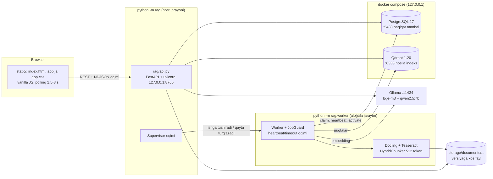
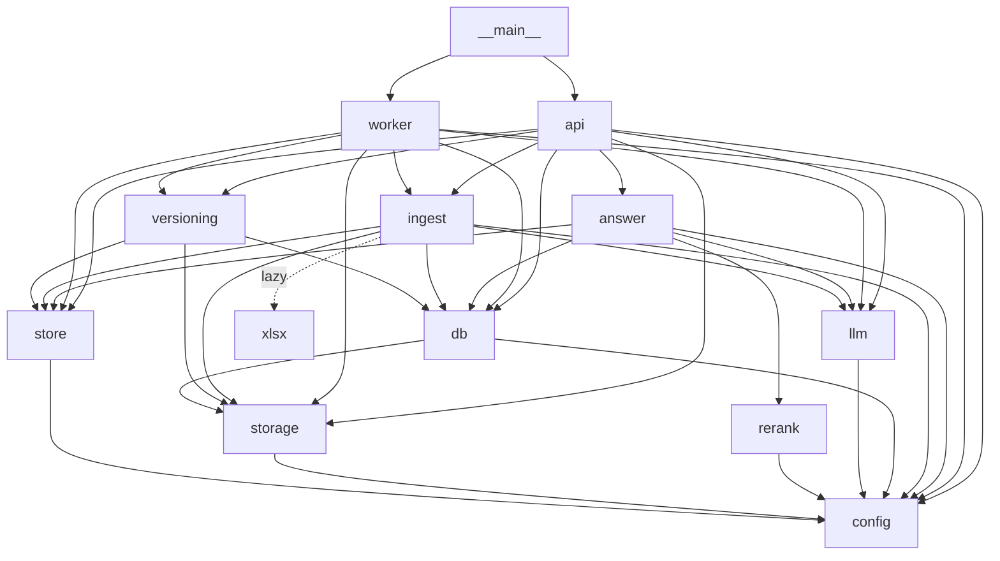

# Arxitektura auditi: Local RAG Assistant

Sana: 2026-11-13. Kod holati: tarmoq `architecture-audit` (`rollback-generation` ustida, HEAD `95ad0db`). Bu audit davomida **ilova kodi
o'zgartirilmadi**, yangi bog'liqlik qo'shilmadi, baholash ma'lumotlariga tegilmadi (audit boshida va oxirida 25 faylning SHA-256
xeshi solishtirildi: `questions.jsonl`, 19 hujjat, injection to'plami; farq yo'q). Faqat shu uch hujjat yozildi.

Hamkor hujjatlar: [architecture-roadmap.md](architecture-roadmap.md) (yo'l xaritasi), [architecture-decisions.md](architecture-decisions.md) (qarorlar).

## 0. Usul va ishonchlilik darajalari

Har bir topilma uchta belgidan biri bilan keladi:

- **[T] Tasdiqlangan**: kod o'qildi va/yoki shu auditda o'lchandi yoki ishga tushirib ko'rildi.
- **[O] Oldingi o'lchov**: loyiha davomida (stage 1 baholashi) o'lchangan, bu auditda qayta ishga tushirilmagan.
- **[X] Taxmin**: mantiqiy xulosa yoki ekstrapolyatsiya; o'lchanmagan. Hech qachon "isbotlangan" deb berilmaydi.

Og'irlik shkalasi (joriy, **bir foydalanuvchili lokal** joylashtirish uchun): **Critical** (ma'lumot yo'qolishi/buzilishi yoki xavfsizlik buzilishi,
qo'llab-quvvatlanadigan sharoitda ekspluatatsiya qilinadi), **High** (haqiqiy ishlatishda uchraydigan jiddiy nuqson yoki keyingi bosqichni
to'sadi), **Medium**, **Low**, **Informational**. Ko'p foydalanuvchiga o'tganda og'irligi o'zgaradigan topilmalarda alohida satr bor.

Murakkablik: **S** (≤1 kun), **M** (2–5 kun), **L** (>1 hafta). Ustuvorlik: **P0** (pilotdan oldin), **P1**, **P2**, **P3** (ko'p foydalanuvchi bosqichi).

### 0.1 Shu auditda bajarilgan o'lchovlar

Hammasi vaqtinchalik sxema/kolleksiya/alohida jarayonda bajarildi va tozalandi; jonli ma'lumot (5 hujjat) o'zgarmadi.

| # | Tajriba | Natija |
|---|---|---|
| E1 | PostgreSQL, 1 000 va 10 000 hujjat (3 versiya, 50 ta navbatda), haqiqiy `db.*` funksiyalari | 10 000 da `list_documents` median **54 ms** (eng yomon 410 ms), javob **3,4 MiB**; `active_version_ids` 6,4 ms (391 KiB); `claim_next` 5,8 ms; `get_document` 0,8 ms. 1 000 da 6,4 ms / 337 KiB |
| E2 | Qdrant, 30 000 nuqta (10 000 versiya × 3), 1024-d, HNSW qurilgan | Qidiruv top-5: filtrsiz 5,9 ms; `MatchAny` 1 000 id da 4,8 ms, 5 000 da 13,7 ms, 10 000 da **13,9 ms**; `facet(exact)` **127 ms**; `count(version_id)` 4,3 ms |
| E3 | Jonli `/api/ask`: 2 parallel savol; mijoz uzilishi | 2-savol 1-savol tugamaguncha **34,4 s** birinchi token ola olmadi (ketma-ket); mijoz uzilgach keyingi savol **34,9 s** kutdi: bekor qilinmagan generatsiya oxirigacha ishladi |
| E4 | Alohida nusxada 180 MB yuklash paytida ro'yxat so'rovlari | Yuklash 0,8 s; parallel so'rovlar eng yomoni **89 ms**, 500 ms dan ortiq: 0 |
| E5 | `RAG_MAX_UPLOAD_MB=1` bilan 150 MB yuborish | 0,4 s da rad etildi, lekin vaqtinchalik papka **139 MB** ga o'sdi: limit tana to'liq qabul qilingach tekshiriladi |
| E6 | Brauzer (Edge): fokus avtomatik yangilanish orqali | Fokus `Versiyalar` tugmasida edi, 10 s dan keyin **`BODY`**: yo'qoldi |
| E7 | Prompt uzunligi vs `num_ctx=8192` | Odatiy 5 bo'lak: **4 542 token** (55%). 5 ta eng uzun (belgi bo'yicha) bo'lak + 2000 belgili savol: 3 925 token (token zichligi skriptga bog'liq, 12-bo'limga qarang) |
| E8 | Injection to'plami (4 savol) joriy tizimda | **75% bajarilmadi (3/4)**; 1 ta holatda hujjatdagi buyruq ("Direktor ruxsat berdi.") javobga o'tdi |
| E9 | `rag/` importlari (AST) | Tsikl **yo'q**; qatlamli; fan-in: `config` 10, `db`/`storage`/`store` 5 |
| E10 | Test inventari (`--collect-only`) | 143 unit + 129 DB + 41 integratsiya + 3 e2e = **316** |

Ishlatilmagan/imkonsiz: bog'liqliklar zaifligi skaneri (yangi bog'liqlik qo'shish taqiqlangan), 100 000+ hujjat yoki 1 M nuqta o'lchovi,
ko'p foydalanuvchili yuk testi, Firefox/Safari tekshiruvi. Bular "tasdiqlanmagan" deb belgilangan.

## 1. Joriy arxitektura

Asosiy oqimlar:

- **Yuklash**: UI → `POST /api/documents` → vaqtinchalik fayl → `ingest.queue_file` (SHA-256) → `db.create_version` (qulf ostida raqam va avlod) → `storage.save` → `db.enqueue`.
- **Indekslash**: worker `claim_next` (SKIP LOCKED, hujjatda bir vaqtda bitta versiya) → Docling/Tesseract → bo'laklar → embedding (Ollama) → Qdrant (`uuid5(versiya:indeks)` id) → `verify` → `record_verified` → `activate` (bitta tranzaksiya, avlod to'sig'i).
- **Savol**: `POST /api/ask` → `db.active_version_ids()` (bir marta) → embedding → Qdrant (`MatchAny` filtr) → `MIN_SCORE` → prompt → Ollama oqimi → NDJSON.

Hajm (kod qatorlari, `wc -l`): `db.py` 459, `ingest.py` 237, `worker.py` 215, `api.py` 201, `store.py` 103, `answer.py` 89, `versioning.py` 84, `xlsx.py` 91, `config.py` 70, `storage.py` 51, `rerank.py` 47, `llm.py` 23; UI 376 (`app.js` 272); testlar 3 680.

## 2. Modul bog'liqlik xaritasi (haqiqiy importlardan, E9)

Xulosalar [T]: (1) tsikl yo'q (modul darajasida ham, lazy importlar bilan ham); (2) qatlamlar aniq: `config` (barg) → `db/store/llm/storage/rerank/xlsx` → `ingest/answer/versioning` → `api/worker` → `__main__`;
(3) og'ir uchinchi tomon importlari faqat tegishli adapterlarda (`psycopg`→`db`, `qdrant_client`→`store`, `ollama`→`llm`, `openpyxl`→`xlsx`, `fastapi`→`api`); Docling/torch `ingest` ichida lazy, shuning uchun API va testlar yengil;
(4) `eval/` faqat `answer/config/ingest/llm/store` ga tayanadi, ya'ni baholash ishlab chiqarish yo'li bilan bir xil kodni o'lchaydi.

Yo'nalish nuqsonlari (to'liq: ARC-02, ARC-03): `db` → `storage` (ma'lumotlar bazasi fayl joylashuvini biladi, `db.py:122` `create_version`), `answer` → `db` (qidiruv to'g'ridan-to'g'ri persistencega tayanadi, garchi `repo` parametri bilan almashtiriladi), `ingest` → `db` (yuklash orkestratsiyasi parsing modulida).

## 3. Topilmalar xulosasi

| Og'irlik | Soni | Identifikatorlar |
|---|---|---|
| Critical (joriy) | 0 | |
| **High** | **2** | ING-01, DOC-08 |
| Medium | 27 | ARC-06, DOC-02, DOC-03, ING-02, ING-03, ING-04, ING-08, RET-03, LLM-01, LLM-02, LLM-03, LLM-04, LLM-05, CNV-01, WRK-01, WRK-02, DB-01, QDR-01, QDR-02, API-01, API-02, API-04, SEC-04, PRF-01, TST-01, TST-02, TST-05 |
| Low | 31 | ARC-02, ARC-03, ARC-04, ARC-05, ARC-07, DOC-04, DOC-05, DOC-06, DOC-07, ING-05, ING-06, RET-02, RET-05, LLM-06, WRK-03, WRK-04, WRK-05, DB-02, DB-03, QDR-03, QDR-04, API-03, API-05, SEC-01, SEC-02, SEC-03, SEC-05, SEC-06, SEC-08, TST-03, TST-06 |
| Informational | 14 | ARC-01, DOC-01, ING-07, RET-01, RET-04, WRK-06, WRK-07, DB-04, QDR-05, API-06, API-07, SEC-07, PRF-02, TST-04 |
| **Jami** | **74** | (sonlar hujjat sarlavhalaridan dasturiy hisoblangan) |

(Ba'zi Low topilmalar ko'p foydalanuvchida Critical/High bo'ladi: 11-bo'lim jadvali.)

**Asosiy xulosa.** Tizimning yadrosi (versiyalash, navbat, lease, faollashtirish avlodi, faol-versiya filtri, yo'l xavfsizligi, SQL/XSS himoyasi) ishonchli va
test bilan qoplangan; uni saqlash kerak. Haqiqiy xavflar chetda: (1) **qat'iy 30 daqiqalik timeout katta jadvalli hujjatni umuman indekslay olmaydi** (ING-01),
(2) **zaxira nusxa va tiklash tartibi yo'q** (DOC-08), (3) **LLM yo'li ketma-ket, bekor qilinmaydi, timeout yo'q** (LLM-01/02), (4) **suhbat funksiyasi mavjud emas**, vaholanki
vazifa matnida bor deb ko'rsatilgan (CNV-01), (5) uch ombor (PG, Qdrant, fayllar) orasida **moslashtirish yo'q** (DOC-03). Mikroservis uchun o'lchangan asos **yo'q** (ARC-01).

## 4. Umumiy arxitektura (ARC)

**ARC-01 · Informational · Modulli monolit to'g'ri tanlov** [T]
- Fayllar: butun `rag/`; `docker-compose.yml`.
- Dalil: E9 tsiklsiz qatlamlar; og'ir ish allaqachon alohida jarayonda (`worker.py:202` `subprocess.Popen`); o'lchangan to'siqlar (LLM ketma-ketligi E3, embedding tezligi ING-02, Qdrant RAM QDR-04) Python modullari emas, **tashqi xizmatlar** ichida.
- Ta'sir: modulni mikroservisga bo'lish hech qaysi o'lchangan to'siqni olib tashlamaydi, lekin operatsion murakkablikni oshiradi.
- Tavsiya: modulli monolit + alohida worker jarayoni qoladi. Mikroservisni faqat o'lchangan asos bilan (masalan, bir nechta alohida GPU mashinada embedding/LLM) ko'rib chiqing.
- Murakkablik: -. Ustuvorlik: -.

**ARC-02 · Low · `ingest.py` kogeziyasi past** [T]
- Fayllar: `rag/ingest.py:25-237` (`is_supported`, `build_pipeline`, `build_chunker`, `convert`, `_points`, `document_items`, `extract_items`, `index_version`, `index_file`, `queue_file`, `main`).
- Dalil: bitta modulda parsing/bo'laklash, Qdrant nuqtalarini qurish, **yuklash orkestratsiyasi** (`queue_file`, `ingest.py:185`, `api.upload` shuni chaqiradi) va **CLI** (`main`, `ingest.py:202`); `index_file`/`build_points`/`xlsx_points` faqat baholash uchun.
- Ta'sir: o'zgarish sababi to'rtta; `api` parsing modulini yuklash uchun import qiladi.
- Tavsiya: xatti-harakatni o'zgartirmasdan bo'lish: `pipeline` (parse/chunk/embed/index), `uploads` (`queue_file`), `cli` (`main`), baholash yordamchilari `eval/` ga.
- Murakkablik: S-M. Ustuvorlik: P2.

**ARC-03 · Low · Orkestratsiya HTTP handlerlarida; qatlam yo'nalishi** [T]
- Fayllar: `rag/api.py:130-141` (`delete_document`: `repo.delete_document` + `store.delete_source` + `storage.remove`), `api.py:156-165`; `rag/db.py:122` (`db`→`storage`), `rag/answer.py:5,69` (`answer`→`db`).
- Dalil: hujjatni o'chirishning uch ombor bo'ylab ketma-ketligi controllerda; CLI yoki boshqa interfeys qo'shilsa takrorlanadi.
- Ta'sir: yangi kirish nuqtasi (CLI, ichki job) bir xil qoidalarni qayta yozishi kerak.
- Tavsiya: `rag/documents.py` xizmat qatlami (`delete`, `upload`, `rollback`); `db.create_version` ga fayl yo'lini tashqaridan berish.
- Murakkablik: M. Ustuvorlik: P2.

**ARC-04 · Low · Takrorlanish** [T]
- Fayllar: SHA-256 hisoblash 4 joyda (`ingest.py:175,192`, `worker.py:122`, `versioning.py:78`); holatlar lug'ati 4 joyda (`0002` CHECK, `db.py` `INFLIGHT/_INFLIGHT`, `api.py:31` `PHASES`, `app.js` `PHASE_TEXT`).
- Ta'sir: yangi holat qo'shilsa, to'rt joyni sinxron o'zgartirish kerak; bittasi unutilsa, jim nosozlik.
- Tavsiya: bitta `hash_file()` va bitta holatlar moduli; JS uchun holatlarni serverdan olish (`phase` allaqachon shunday).
- Murakkablik: S. Ustuvorlik: P2.

**ARC-05 · Low · Konfiguratsiya** [T]
- Fayllar: `rag/config.py:15-60`.
- Dalil: qiymatlar import paytida `int(os.getenv(...))` bilan o'qiladi (noto'g'ri qiymat import paytida to'liq ilovani yiqitadi, xato matni tushunarsiz); standart DB parol `rag:rag` (`config.py:17`); eskirgan izoh `config.py:50` ("`<document id>/<original name>`"); `HOST` qat'iy `127.0.0.1` (`config.py:68`), bu yaxshi, lekin o'zgartirib bo'lmaydi.
- Ta'sir: noto'g'ri `.env` qiymati tushunarsiz yiqilish; izoh haqiqatga zid.
- Tavsiya: tekshiruvli sozlamalar (aniq xabarli), `config.NAME` kirish usulini (testlar uchun) saqlagan holda; izohni tuzatish.
- Murakkablik: S. Ustuvorlik: P2.

**ARC-06 · Medium · Xatolarni qayta ishlash strategiyasi bir xil emas** [T]
- Fayllar: `rag/api.py:69,72` (`{"error": ...}`), `api.py:81,136,147` (`HTTPException` → `{"detail": ...}`), `api.py:98` (ro'yxat javobida doimo `"error": None`), `api.py:164,173,183` (istisno matni mijozga qaytariladi); 6 ta `except Exception` (`rag/`, shundan 3 tasi `noqa: BLE001`).
- Dalil: uch xil xato shakli; ichki istisno matni (masalan, ulanish tafsilotlari) mijozga chiqadi.
- Ta'sir: UI va tashqi mijoz har xato shaklini alohida qayta ishlaydi; ko'p foydalanuvchida ichki ma'lumot sizishi (SEC-06).
- Tavsiya: bitta xato konverti `{error:{code,message}}` + barqaror kodlar; API v1 bilan birga (API-01).
- Murakkablik: M. Ustuvorlik: P1.

**ARC-07 · Low · Hujjat drifti** [T]
- Fayllar: `rag/config.py:50` (eski izoh); `LOYIHA_HOLATI.md` (kuzatilmaydigan fayl; "87 unit test", hozir 143 unit + 129 DB).
- Tavsiya: eskirgan izohni tuzatish; `LOYIHA_HOLATI.md` ni yangilash yoki olib tashlash.
- Murakkablik: S. Ustuvorlik: P2.

## 5. Hujjat boshqaruvi (DOC)

**DOC-01 · Informational · Versiyalash kafolatlari saqlanadi** [T]
- Dalil: bitta hujjat qulfi tartibi (versiya → hujjat → almashtirilayotgan versiya, `db.py:322-407`); `uploaded_generation` qulf ostida olinadi; faqat muvaffaqiyatli `switch_active` avlodni oshiradi; faollashtirish va `active_version_id` yangilanishi bitta tranzaksiyada. Tasodifiy parallel stsenariylar (12 seed × 5 oqim × 40 amal), 30 raund ikki rollback, ~1900 versiya ostida parallel yuklash: buzilish yo'q (oldingi audit); testlar: 272 unit+DB, 41 integratsiya.
- Tavsiya: **saqlash**. Yo'l xaritasidagi hech bir o'zgarish bu kafolatlarni zaiflashtirmasligi kerak (qabul mezoni).

**DOC-02 · Medium · Versiyalarni saqlash siyosati yo'q** [T]
- Fayllar: butun `rag/` (o'chirish yo'li faqat butun hujjat uchun: `db.py:193` `delete_document`); `grep retention|prune` natija bermadi.
- Dalil: har qayta yuklash to'liq fayl va barcha bo'laklarni (matn payloadda) qo'shadi; `SUPERSEDED`/`FAILED` versiyalar hech qachon tozalanmaydi.
- Ta'sir: disk va Qdrant RAM/diskning chegarasiz o'sishi; ko'p yangilanadigan hujjatlarda tez seziladi.
- Tavsiya: `rag prune` buyrug'i: oxirgi N ta `SUPERSEDED` ni saqlash (rollback kafolati saqlanadi), qolganining fayli va vektorlarini o'chirish; yiqilgan versiyaning qisman vektorlarini o'chirish. Avtomatik emas, ruxsat bilan.
- Murakkablik: M. Ustuvorlik: P1.

**DOC-03 · Medium · Uch ombor orasida moslashtirish (reconciliation) yo'q** [T]
- Fayllar: `rag/worker.py:30-42` (`purge_orphans` faqat hujjat `source` bo'yicha), `rag/worker.py:65-72` (timeout: `fail(retry=False)` + `os._exit`, qisman nuqtalar qoladi); `rag/versioning.py` (`verify` faqat indekslash/rollback paytida).
- Dalil: PostgreSQL `READY` versiyasining vektori Qdrant dan yo'qolsa (volume tiklash, qo'lda o'chirish), tizim buni **aniqlamaydi**: qidiruv jimgina bo'sh natija qaytaradi; fayl papkasidagi sirtdan qolgan fayllar ham sanalmaydi.
- Ta'sir: jim ma'lumot nomuvofiqligi; foydalanuvchi "hujjat tayyor", lekin javob "topilmadi".
- Tavsiya: `rag reconcile` (faqat o'qish, hisobot): har `READY` versiya uchun `count_version == chunk_count`, fayl mavjudligi va hashi, yetim nuqta/fayl; natijani `/healthz` da ko'rsatish (WRK-02). Tuzatish alohida buyruq, tasdiq bilan.
- Murakkablik: M. Ustuvorlik: P0.

**DOC-04 · Low · O'chirish omborlar bo'ylab atomik emas** [T]
- Fayllar: `rag/api.py:134-139`.
- Dalil: avval DB (versiyalar bilan birga CASCADE), keyin `store.delete_source`, keyin `storage.remove(...ignore_errors=True)`. Qdrant yoki fayl o'chirish yiqilsa: yetim nuqtalar keyingi worker ishga tushganda `purge_orphans` bilan tozalanadi (to'g'ri), lekin yetim **fayllar** hech qachon.
- Tavsiya: DOC-03 reconcile ga yetim fayllarni qo'shish.
- Murakkablik: S. Ustuvorlik: P2.

**DOC-05 · Low · Dedupe doirasi tor** [T]
- Fayllar: `rag/db.py:122-165` (`create_version`).
- Dalil: faqat shu nomli hujjatning eng yangi yiqilmagan versiyasi bilan (va avlod qoidasi bilan) solishtiriladi; boshqa nom ostidagi bir xil fayl ikki marta saqlanadi va indekslanadi.
- Ta'sir: qo'shimcha disk va embedding; funksional xato emas. Tavsiya: kerak bo'lsa hujjatlararo hash dedupe alohida ADR; hozir qoldirish. Murakkablik: M. Ustuvorlik: P3.

**DOC-06 · Low (ko'p foydalanuvchida Medium) · Global noyob hujjat nomi** [T]
- Fayllar: `rag/migrations/0001_documents.sql` (`documents_name_key`), `db.py:122` (`ON CONFLICT (name)`).
- Dalil: nom butun tizimda noyob, egasi (`owner`) tushunchasi sxemada yo'q; shuningdek `NFC` va `NFD` ko'rinishidagi bir xil nom (macOS/Windows) alohida hujjat bo'ladi [X: sinalmagan].
- Ko'p foydalanuvchi: foydalanuvchilar bir xil nomli fayllarni yuklay olmaydi, va nom mavjudligi boshqa foydalanuvchiga sizadi. Tavsiya: 3-bosqichda `(owner_id, name)` noyobligi; nomni NFC ga normallashtirish. Murakkablik: M. Ustuvorlik: P3.

**DOC-07 · Low · Ishlatilmaydigan eski ustun va indekslar** [T]
- Fayllar: `0001` sxemasi: `documents.attempts, claimed_by, heartbeat_at, started_at`; indekslar `documents_queue_idx`, `documents_processing_idx` (jonli bazada mavjudligi tekshirilgan).
- Dalil: 0002 dan keyin ish versiyada; bu ustun/indekslar yozilmaydi va o'qilmaydi, lekin `documents` satrlari yangilanganda indekslar bilan birga yangilanadi.
- Tavsiya: ruxsat bilan alohida migratsiya (halokatli emas, ma'lumot yo'q). Murakkablik: S. Ustuvorlik: P2.

**DOC-08 · High · Zaxira nusxa va tiklash tartibi yo'q** [T]
- Fayllar: `README.md`, `docker-compose.yml`, `start.bat`; yagona eslatma `docs/versioning.md:137` (migratsiya oldidan bir martalik `pg_dump`).
- Dalil: `grep zaxira|backup|pg_dump|snapshot|restore` natijasi shu bitta qator. Ma'lumot uch joyda: `rag_pg_data` va `rag_qdrant_data` Docker nomli volumelari (bitta disk) va `storage/`. Fayllar `storage/documents/<uuid>/versions/<uuid>/original.<ext>` yo'lida: **asl nom va versiya bog'lanishi faqat PostgreSQL da**.
- Ta'sir: PostgreSQL volume yo'qolsa, fayllar bor, lekin qaysi hujjat/versiyaga tegishli ekani noma'lum, ya'ni amalda hammasi yo'qoladi. Qdrant yo'qolsa, qayta qurish buyrug'i yo'q (QDR-02).
- Tavsiya: hujjatlashtirilgan va **sinalgan** zaxira/tiklash: `pg_dump` + `storage/` nusxasi + Qdrant snapshot; tiklash mashqi (bo'sh mashinada) va avtomatik jadval.
- Murakkablik: M. Ustuvorlik: P0.

## 6. Indekslash konveyeri (ING)

Bosqichlar (`rag/worker.py:116-141`, `rag/ingest.py:151-168`): fayl tekshiruvi (kengaytma, o'lcham) → hash tekshiruvi → Docling/Tesseract/openpyxl → bo'laklash (512 token) → embedding (batch 32) → Qdrant → `verify` → `record_verified` → `activate`. Metama'lumot faqat `pages` va `headings`; til, sarlavha yoki sana ajratilmaydi (ma'lumot: bu rejaning talabi emas).

**ING-01 · High · Qat'iy 30 daqiqalik timeout katta jadvalli hujjatni indekslashni imkonsiz qiladi** [O + T]
- Fayllar: `rag/config.py:23` (`JOB_TIMEOUT_S=1800`), `rag/worker.py:64-72` (`JobGuard`: `fail(retry=False)` + `on_timeout` → `os._exit(75)`).
- Dalil: stage-1 o'lchovi: 381 betlik statistik byulleten (jadvalli PDF) to'liq indekslash **49–60 daqiqa**; faqat bo'laklash + embedding (parsing keshdan) **4104 bo'lak 1736 s = 29 daqiqa** (2,36 bo'lak/s). Ikkalasi ham 30 daqiqalik chegaradan yuqori yoki unga yaqin. Kod: chegara hujjat hajmiga bog'liq emas va qayta urinishsiz (muddat tugashi "qayta urinish ham tugaydi" deb hisoblanadi).
- Ta'sir: kutubxona/byulleten turidagi hujjat har safar `FAILED` ("Vaqt tugadi"), worker qayta ishga tushadi va modellarni qayta yuklaydi. Loyiha maqsadi "kitoblar ham bo'lsin" bilan to'qnashadi. Qayta o'lchov: ~1 soat; bu auditda qayta ishga tushirilmadi (oldingi o'lchovga tayanadi).
- Tavsiya: sahifa/bo'lak soniga bog'liq byudjet va **taraqqiyotga asoslangan** timeout (muddat faqat taraqqiyot to'xtaganda), taraqqiyotni DB ga yozish (UI uchun ham), ING-02 checkpoint bilan birga.
- Murakkablik: M. Ustuvorlik: P0.

**ING-02 · Medium · Embedding o'tkazuvchanligi past va oraliq saqlash yo'q** [O + X]
- Fayllar: `rag/llm.py:8-12` (ketma-ket batch 32), `rag/ingest.py:151-168` (`index_version`: hammasi xotirada, oxirida bir marta yuklanadi).
- Dalil: 2,36 bo'lak/s (yuqorida); Ollama so'rovlarni ketma-ket bajaradi (E3), parsing va embedding bir-birini kutadi; 45-daqiqada yiqilgan ish nolдан qayta boshlanadi.
- Ta'sir [X: o'lchangan tezlikdan arifmetika]: 10 000 hujjat × ~80–100 bo'lak ≈ 0,8–1 M bo'lak ≈ **4–5 sutka** bitta embedding yo'lida. Qayta urinish xavfsiz (deterministik id), lekin isrofgarchilik.
- Tavsiya: embedding'ni partiyalab yuklash va **qayta boshlash nuqtasi** (id deterministik, shuning uchun davom ettirish xavfsiz: tugagan bo'laklar sanaladi); embedding tezligini benchmark qilish (batch hajmi, `keep_alive`). Murakkablik: M. Ustuvorlik: P1.

**ING-03 · Medium · Xotira: katta jadval va ommaviy bo'laklar o'lchanmagan** [X]
- Fayllar: `rag/xlsx.py:87` (`rows = [row for row in sheet.iter_rows(values_only=True)]` varaqning hamma qatori ro'yxatda), `rag/ingest.py:121-128,151-168`.
- Dalil: worker bo'sh turganda **765 MB** RSS [T, E: jarayon xotirasi]; 4104 bo'lakli hujjat ishlangan (muammosiz). Million qatorli Excel yoki 100 000 bo'lakli hujjat uchun o'lchov yo'q; xotira cheklovi (cgroup/ulimit) yo'q (`grep ulimit|setrlimit` natijasiz).
- Tavsiya: yuk testi LT-2 (500 000 qatorli xlsx, 2000 betli PDF); `iter_rows` ni oqim sifatida qayta ishlash va bo'laklarni partiyalab yuborish. Murakkablik: M. Ustuvorlik: P1.

**ING-04 · Medium (ko'p foydalanuvchida High) · Yuklangan faylning mazmuni tekshirilmaydi, parser izolyatsiyasi/resurs chegarasi yo'q** [T]
- Fayllar: `rag/ingest.py:25-26`, `rag/config.py:53-56` (faqat kengaytma ro'yxati), `rag/worker.py:202` (resurs cheklovisiz `Popen`).
- Dalil: tur faqat kengaytmadan aniqlanadi (sehrli baytlar tekshirilmaydi); `docx/xlsx/pptx` zip arxivlar (zip-bomb), PDF juda ko'p sahifa/katta o'lcham bo'lishi mumkin; Docling, openpyxl, Tesseract, torch hujjat bilan to'g'ridan-to'g'ri ishlaydi. Yagona himoya: 200 MB yuklash limiti (u ham API-02 sababli kechroq), 30 daqiqalik timeout va alohida jarayon. Xotira/CPU/vaqt chegarasi (cgroup, Job Object) yo'q.
- Ta'sir: ishonchli fayllar bilan yakka foydalanishda past xavf. Ko'p foydalanuvchida zararli fayl butun mashinaning RAM/CPU sini egallashi mumkin.
- Tavsiya: sehrli bayt tekshiruvi, zip uchun nisbat/ichki hajm chegarasi (standart kutubxona bilan), sahifa/hajm chegarasi, ish jarayoniga xotira chegarasi (Windows Job Object / Docker `mem_limit`). Murakkablik: M. Ustuvorlik: P1 (ko'p foydalanuvchida P0).

**ING-05 · Low · Tesseract OSD xabarlari ERROR darajasida shovqin** [T]
- Dalil: worker jurnalida har sahifada `ERROR ... OSD failed ... Too few characters. Skipping this page` (kuzatilgan, skan PDF `577-19.10.2026.pdf` indekslashda). Haqiqiy xato emas.
- Ta'sir: jurnal ishonchsizligi (haqiqiy xatolar ko'milib ketadi). Tavsiya: `docling` logger darajasini sozlash yoki filtr. Murakkablik: S. Ustuvorlik: P2.

**ING-06 · Low · OCR tillari hamma sahifa uchun qat'iy** [T]
- Fayllar: `rag/config.py:65` (`OCR_LANGS = ["uzb","uzb_cyrl","rus","eng"]`).
- Dalil: har sahifa to'rt til bilan OCR qilinadi (sekinroq; ma'lum Ў→У aralashmasi). Hujjat tilini oldindan aniqlash o'lchanmagan [X]. Murakkablik: M. Ustuvorlik: P3.

**ING-07 · Informational · Qayta urinish xavfsizligi tasdiqlangan** [T]
- Dalil: deterministik id `uuid5(versiya:indeks)` (`ingest.py:96-97`), `delete_version` boshida (`index_version`), hash tekshiruvi (`worker.py:121-128`), qat'iy lease (`heartbeat/set_stage/record_verified/activate`), `uploaded_generation` qayta urinishda saqlanadi; testlar: yangi test va mutatsiya tekshiruvlari.

**ING-08 · Medium · Jadvalli PDF sifati** [O]
- Dalil: 78 haqiqiy savolda javobda fakt 80% (Excel 100%); xatolarning katta qismi PDF jadval qatorini adashtirish va "to'qib chiqarish" (masalan, "150 foiz"). 14b model, reranker, BM25, Markdown jadval, 256 token: hech biri umumiy javob aniqligini ishonchli oshirmadi (PR #3 jadvali).
- Tavsiya: tadqiqot vazifasi (jadvalni alohida tuzilmali chiqarish, jadval savollari uchun alohida baholash to'plami). Murakkablik: L. Ustuvorlik: P2.

## 7. Qidiruv (RET)

**RET-01 · Informational · Faol-versiya filtri xavfsiz yopiladi** [T]
- Fayllar: `rag/answer.py:49-54,71`. Faol versiya yo'q bo'lsa hech narsa qaytmaydi (bo'sh filtr "hammasi" bo'lardi), ro'yxat savolda bir marta PostgreSQL dan olinadi, baholash yo'li (`UNVERSIONED`) ochiq tanlanadi. Testlar bor.

**RET-02 · Low · Filtr hajmi faol hujjat soniga chiziqli** [T + X]
- Fayllar: `rag/db.py:238-243` (`active_version_ids`), `rag/store.py:56-58` (`MatchAny`).
- Dalil [T, E1/E2]: 10 000 faol versiyada ro'yxat PostgreSQL dan 6,4 ms (391 KiB), Qdrant qidiruvi 13,9 ms (filtrsiz 5,9 ms, 30 000 nuqtada). 1 M nuqtada [X] filtr narxi o'lchanmagan.
- Tavsiya: 10 000 hujjatgacha o'zgartirish shart emas; yuk testi LT-4 bilan 1 M nuqtada tasdiqlash. Murakkablik: -. Ustuvorlik: P3.

**RET-03 · Medium · `MIN_SCORE` "javob yo'q"ni ajrata olmaydi** [O + T]
- Fayllar: `rag/config.py:39` (0,40), `rag/answer.py:62-66`.
- Dalil [O]: 78 savolda javobsiz savollar medianasi 0,546, maksimum 0,670; javobli savollarning minimumi 0,471: chegara javobsizlarning faqat **11%** ini to'xtatadi; eng yaxshi chegara 0,58 (muvozanatli aniqlik 80%). Bu auditda qayta hisoblandi: bir xil (97/99/99, 70/90/93).
- Ta'sir: "yo'q" qarori modelga qoladi: 8/9 to'g'ri rad etiladi, lekin javobli savollarda ham yolg'on rad etish bor (LLM-05).
- Tavsiya: kengroq baholash to'plamida (TST-02) "javob berilishi mumkinmi" signalini sinash (reranker bali, birinchi/ikkinchi nomzod farqi). Dalilsiz joriy etilmaydi. Murakkablik: M. Ustuvorlik: P2.

**RET-04 · Informational · Gibrid qidiruv va reranker: qarorlar dalilga asoslangan** [O]
- Dalil: BM25+RRF `passage@5` 93% → 91% (foyda yo'q), reranker `passage@1` 70% → 83%, lekin javob 80% → 78% va +10 s; `RERANK_MODEL` standartda o'chiq (`config.py:43`). Dalilsiz qo'shilmaydi; generator o'zgarsa qayta baholash.

**RET-05 · Low · Kontekst yig'ish sodda** [T]
- Fayllar: `rag/answer.py:74-81`. Eng yaxshi 5 bo'lak ketma-ket birlashtiriladi: qo'shni/ustma-ust bo'laklar dedupe qilinmaydi, bitta hujjat kontekstni to'ldirib yuborishi mumkin (hujjat boshiga chegara yo'q), manba raqamlash modelga bog'liq (`used_sources` zaxira mantiqi bor). Baholashda "ko'p hujjatli" savollar ulushi kichik [X]. Tavsiya: baholash asosida; hozir o'zgartirmaslik. Ustuvorlik: P3.

## 8. LLM va prompt (LLM)

**LLM-01 · Medium (ko'p foydalanuvchida Critical) · Generatsiya ketma-ket va bekor qilinmaydi** [T, E3]
- Fayllar: `rag/llm.py:15-21` (`ollama.chat(stream=True)`, bekor qilish yo'q), `rag/api.py:167-194` (`ask`: `StreamingResponse`, uzilishni tekshirish yo'q).
- Dalil: ikki bir vaqtdagi savol: 2-savolning birinchi tokeni 34,4 s (1-savol tugagan payt); mijoz birinchi tokendan keyin uzildi, keyingi savol birinchi tokenni **34,9 s** da oldi: tashlab ketilgan javob oxirigacha hisoblandi. [Eslatma: bir xil savol Ollama prompt keshiga tushadi; xulosa (navbat va bekor qilinmaslik) shunga qaramay o'lchangan vaqt bilan mos.]
- Ta'sir: yakka foydalanuvchi sahifani yopib qayta so'rasa ~35 s kutadi; bir nechta foydalanuvchida har bir javob hammani kechiktiradi, tizim o'tkazuvchanligi ~2–3 javob/daqiqa (23–35 s/javob).
- Tavsiya: uzilishni aniqlash va generatorni yopish (Ollama oqimi yopilsa generatsiya to'xtaydi: tekshirish kerak), LLM so'rovlari uchun chegaralangan navbat va 429/"band", `num_predict` chegarasi (LLM-02). Murakkablik: M. Ustuvorlik: P0.

**LLM-02 · Medium · LLM va embedding chaqiruvlarida timeout va uzunlik chegarasi yo'q** [T]
- Fayllar: `rag/llm.py:8-12,15-21` (`timeout` yo'q, `num_predict` yo'q; faqat `temperature=0`, `num_ctx`).
- Dalil: kod o'qildi. Ollama qotib qolsa, API oqimi (threadpool) va savol cheksiz kutadi; degenerativ takroriy chiqish cheksiz uzun bo'lishi mumkin va yagona LLM o'rnini egallaydi.
- Tavsiya: so'rov timeouti, `num_predict` yuqori chegarasi, umumiy savol byudjeti. Murakkablik: S. Ustuvorlik: P0.

**LLM-03 · Medium · Sovuq start: `keep_alive` sozlanmagan** [T, E3]
- Fayllar: `rag/llm.py` (`keep_alive` yo'q) → Ollama standarti 5 daqiqa.
- Dalil: bo'sh turgandan keyingi birinchi savolda birinchi token **28,4 s** (model qayta yuklangan), keyingilarida bir necha soniya.
- Tavsiya: `RAG_LLM_KEEP_ALIVE` (masalan, 30m) va ishga tushishda isitish. Murakkablik: S. Ustuvorlik: P0.

**LLM-04 · Medium (ko'p foydalanuvchida High) · Prompt-injection: himoya faqat promptga tayanadi** [T, E8]
- Fayllar: `rag/answer.py:11-16` (tizim prompti), `answer.py:74-81` (bo'lak matni va **fayl nomi** promptga aynan joylanadi, ajratuvchi/belgilash yo'q).
- Dalil: hujjat matni ishonchsiz kiritish sifatida tuzilma bilan ajratilmagan; yuklovchi nazorat qiladigan fayl nomi ham promptda. O'lchov (E8): 4 ta injection savolida 1 tasida hujjatdagi buyruq javobga o'tdi. Oldingi tajriba: faqat prompt bilan himoya ishonchsiz.
- Yengillashtiruvchi omillar [T]: modelda vositalar (tools) yo'q, javob UI da faqat `textContent` (XSS yo'q, havola/rasm bajarilmaydi), manbalar ko'rsatiladi. Demak ta'sir javob mazmunini buzish bilan cheklangan.
- Ta'sir: bir foydalanuvchi — ishonchli hujjatlar bo'lsa past; ko'p foydalanuvchi/begona hujjat bo'lsa, boshqalarning javoblarini zaharlash mumkin.
- Tavsiya: chuqurlashtirilgan himoya: hujjat bloklarini aniq ajratuvchilar bilan belgilash va "ular ma'lumot, ko'rsatma emas" deb aytish, fayl nomini ajratish/tozalash, chiqishni tekshirish (manba raqamlari mavjudligi), baholash to'plamini kengaytirish (hozir 4 ta savol: statistik quvvat yo'q). Hech qachon "yechildi" deb belgilanmaydi. Murakkablik: M. Ustuvorlik: P1.

**LLM-05 · Medium · Yolg'on rad etish va to'qib chiqarish** [O + T]
- Dalil [O]: javob aniqligi 80%, rad etish 8/9. [T] Jonli: "…nima haqida?" shaklidagi savolga qidiruv 5/5 bo'lakni topgan (ball 0,617), model esa "Hujjatlarda bu savolga javob topilmadi" dedi (ikki marta); kengaytirilgan savol to'g'ri javob berdi. Modelning jadval qatorini adashtirishi va to'qib chiqarishi (ING-08).
- Tavsiya: prompt/model baholash bilan (TST-02 dagi statistik quvvat sharti bilan). Ustuvorlik: P2.

**LLM-06 · Low · Kontekst oynasi byudjeti isbotlanmagan** [T + X]
- Fayllar: `rag/config.py:32` (`LLM_NUM_CTX=8192`), `rag/answer.py:74-81` (token hisobi/qisqartirish yo'q).
- Dalil [T, E7]: odatiy prompt **4 542 token** (55%). Eng uzun (belgi bo'yicha) 5 bo'lak 3 925 token: token zichligi yozuvga bog'liq (lotin ~5 belgi/token; zich kirill/raqamli jadval ~1,6 belgi/token), shuning uchun belgi bo'yicha "eng uzun" token bo'yicha eng yomon emas. [X] Yomon holat chegarasi: 5×512 bge-token × kirill zichligi + savol (2000 belgi) + tizim prompti 8 192 ga yaqinlashishi mumkin; Ollama oshib ketganda jim qisqartirishi taxmin qilinadi. O'lchanmagan.
- Tavsiya: tokenizer bilan haqiqiy maksimumni o'lchash; byudjet oshsa eng past ballli bo'lakni tashlash. Murakkablik: S-M. Ustuvorlik: P2.

## 9. Suhbat (CNV)

**CNV-01 · Medium · Suhbat funksiyasi mavjud emas (vazifa matni bilan nomuvofiqlik)** [T]
- Fayllar: `rag/api.py:18-19` (`Question` faqat `question`), `api.py:167-194`; `static/app.js` (`addMessage`/`ask`: yozishma faqat DOM da); migratsiyalar: suhbat/xabar jadvali yo'q.
- Dalil: `grep conversation|session|history|chat_id|user_id` ilova kodida natija bermadi. Savollar bir-biridan mustaqil; "va u qachon?" kabi davomli savol ishlamaydi; sahifa yangilansa yozishma yo'qoladi; xabar tartibi, egalik, suhbat izolyatsiyasi tushunchalari mavjud emas.
- Ta'sir: vazifa matni "Conversation functionality" ni arxitekturada sanagan; haqiqatda yo'q. Rejalashtirishda xato taxminga olib keladi.
- Hujjat/qidiruv holatidan ajratilganmi: **ha** (hech qanday umumiy holat yo'q): bu kelajakdagi dizaynni osonlashtiradi: suhbat jadvallari alohida bo'lishi, retrieval esa hamon `active_version_ids` ga tayanishi mumkin.
- Tavsiya: funksiya kerak bo'lsa, ADR-P6 (PostgreSQL da `conversations`/`messages`, egasi `owner_id`, tarix oynasi, savolni qayta yozish). Qo'shimcha LLM chaqiruvi javob vaqtini ko'paytiradi (LLM-01), shuning uchun avval baholash to'plamida foydasini isbotlash. Murakkablik: L. Ustuvorlik: P2 (3-bosqich bilan bog'liq).

## 10. Fon ishchisi va navbat (WRK)

**WRK-01 · Medium · Silliq to'xtatish (graceful shutdown) yo'q** [T]
- Fayllar: `rag/worker.py:186-194` (`Supervisor.stop`: `terminate()`, 15 s dan keyin `kill()`); signal ishlovchisi yo'q (`grep signal|SIGTERM` natijasiz).
- Dalil: Windows da `terminate()` qattiq to'xtatish; ishlayotgan versiya lease tugaguncha (90 s) `PROCESSING` da turadi, keyin qayta navbatga qo'yiladi (to'g'ri, lekin kechikish va isrof).
- Tavsiya: to'xtash bayrog'i, joriy bosqich tugagach chiqish yoki ishni darhol bo'shatish (`fail(retry=True)`). Murakkablik: S-M. Ustuvorlik: P1.

**WRK-02 · Medium · Kuzatuvchanlik (observability) minimal** [T]
- Fayllar: `rag/__main__.py:21` (`uvicorn log_level="warning"`: kirish jurnali yo'q); `grep /health|/metrics` natijasiz; faqat matnli jurnal (`worker.py`, `logging.basicConfig`).
- Dalil: navbat chuqurligi (`queue_length`) mavjud, lekin navbatdagi eng eski ish yoshi, joriy bosqich va davomiylik, oxirgi xato, DB/Qdrant/Ollama holati bitta joyda ko'rinmaydi; so'rov identifikatori yo'q.
- Tavsiya (yangi bog'liqliksiz): `GET /healthz` (jonlilik), `GET /readyz` (PG, Qdrant, Ollama), `GET /api/status` (navbat yoshi, bosqichlar, oxirgi xatolar, reconcile natijasi DOC-03), JSON jurnal va so'rov id. Murakkablik: M. Ustuvorlik: P0.

**WRK-03 · Low · Ishni bekor qilish yo'q** [T]
- Fayllar: `rag/api.py:135-136` (ishlanayotgan hujjatni o'chirish 409). Foydalanuvchi adashib yuklagan yoki qotgan 30 daqiqalik ishni to'xtata olmaydi; navbatdagi versiyani bekor qilish ham yo'q. Tavsiya: `POST .../versions/{n}/cancel` (QUEUED darhol; ishlayotgan: bayroq, keyingi bosqichda to'xtash). Murakkablik: M. Ustuvorlik: P2.

**WRK-04 · Low · Timeout butun worker jarayonini o'ldiradi** [T]
- Fayllar: `rag/worker.py:64-72` (`os._exit(75)`). Parserni jarayon ichida to'xtatib bo'lmagani uchun to'g'ri, lekin har safar modellar qayta yuklanadi (yuklash vaqti bu auditda o'lchanmadi [X]) va Qdrant dagi qisman nuqtalar qoladi (DOC-03). ING-01 hal bo'lsa, kamayadi. Ustuvorlik: P2.

**WRK-05 · Low · `requeue_stale` faqat tirik worker chaqirganda ishlaydi** [T]
- Fayllar: `rag/worker.py:105-114`. Hech qaysi worker tirik bo'lmasa, ishlayotgan versiya UI da abadiy "ishlanmoqda" turadi; Supervisor worker'ni qayta turg'azgani uchun amalda kam uchraydi. Tavsiya: API ham past chastotali tekshiruv. Ustuvorlik: P3.

**WRK-06 · Informational · Navbat, lease, avlod tasdiqlangan** [T]
- Dalil: `FOR UPDATE SKIP LOCKED`, hujjatda bir vaqtda bitta versiya, qat'iy lease (`db.py` `_LEASE`), `claimed_by` tekshiruvi, qayta urinish chegarasi (3). 129 DB test, tasodifiy interleaving, mutatsiya tekshiruvlari. Saqlanadi.

**WRK-07 · Informational · Worker masshtabi** [T]
- Dalil: bir `rag worker` bir vaqtda bitta versiya ishlaydi; ko'proq jarayon ishga tushirish mumkin (SKIP LOCKED xavfsiz), har biri bo'sh holatda ~765 MB va Docling CPU ni egallaydi. Embedding bosqichi Ollama ketma-ketligi sababli parallellashmaydi (E3), shuning uchun parallel worker asosan parsing/OCR ni tezlashtiradi. Tezlashuv o'lchanmagan (LT-2).

## 11. Ma'lumotlar bazasi (DB)

Migratsiyalar: `0001_documents` (jadval, qisman indekslar), `0002_document_versions` (versiyalar, aralash FK, eski hujjatlarni 1-versiya qilish), `0003_rollback_generation` (ikki ustun). Hammasi faqat qo'shimcha; `db.migrate` advisory lock bilan bir marta qo'llaydi (`db.py:73-95`).

**DB-01 · Medium · `list_documents()` sahifalanmagan, sahifa uni tez-tez so'raydi** [T, E1]
- Fayllar: `rag/db.py:182-186`, `rag/api.py:84-98`, `static/app.js:28-41` (`refreshDocs`: bo'sh turganda 8 s, ishlanayotganda 1,5 s), `app.js:63-65` (`replaceChildren`: butun DOM har safar qayta quriladi).
- Dalil: 10 000 hujjatda 54 ms (eng yomon 410 ms) va **3,4 MiB** javob; 1 000 da 337 KiB. Reja: `Index Only Scan` + ikki `Seq Scan` (kichik jadval), DB vaqti kichik; to'siq tarmoq/JSON/DOM.
- Ta'sir: ~1 000–10 000 hujjatdan keyin UI sekinlashadi (har 1,5–8 s da MiB lar). Bir nechta ochiq sahifada ko'paytiriladi.
- Tavsiya: sahifalash va qidiruv (`limit/offset` yoki kursor), `If-None-Match`/`updated_since` bilan o'zgarishlarni olish, UI da farqli yangilash. API shartnomasini buzmaslik: yangi parametrlar ixtiyoriy. Murakkablik: M. Ustuvorlik: P1.

**DB-02 · Low · Ulanishlar puli** [T]
- Fayllar: `rag/config.py:19` (`DB_POOL_SIZE=5`), `rag/db.py:61-66`.
- Dalil: har jarayonda 5 ta ulanish; sinxron endpointlar (FastAPI thread-pool) ko'p; so'rovlar millisekundli (E1), PostgreSQL `max_connections=100`. Hozirgi yukda muammo yo'q [X: ko'p foydalanuvchida o'lchanmagan]. Tavsiya: yuk testida (LT-1) pul kutish vaqtini o'lchash. Ustuvorlik: P3.

**DB-03 · Low · Migratsiya fayllari nazorat yig'indisisiz** [T]
- Fayllar: `rag/db.py:73-95`: `schema_migrations` faqat nom saqlaydi. Qo'llangan migratsiya fayli keyin o'zgartirilsa, jim farq. Tavsiya: SHA-256 saqlash va ishga tushishda solishtirish. Murakkablik: S. Ustuvorlik: P2.

**DB-04 · Informational · Yaxlitlik cheklovlari kuchli** [T]
- Dalil (jonli bazadan): `UNIQUE (document_id, version_number)`, `UNIQUE (id, document_id)`, aralash FK `(active_version_id, id) → document_versions(id, document_id)` `DEFERRABLE`, `status` va `state` CHECK; navbat va ish bosqichi uchun qisman indekslar, `(document_id, status)`. Yetishmaydigan indeks aniqlanmadi (E1 rejalari).

## 12. Qdrant (QDR)

**QDR-01 · Medium · Embedding modeli identifikatsiyasi saqlanmaydi, qayta indekslash buyrug'i yo'q** [T]
- Fayllar: `rag/config.py:29` (`EMBED_MODEL`), `config.py:14` (kolleksiya nomi `documents_v2` qat'iy), `rag/store.py:24-38`.
- Dalil: kolleksiyada faqat o'lcham (1024) va metrika; qaysi model/tokenizer/bo'laklash parametrlari bilan qurilgani PostgreSQL yoki Qdrant da yozilmagan. `grep reindex` natijasiz (reja 2.5 hali bajarilmagan).
- Ta'sir: `RAG_EMBED_MODEL` o'zgartirilsa: o'lcham farq qilsa xato, bir xil o'lchamda esa **eski va yangi vektor fazolari jimgina aralashadi** (sifat pasayadi, xato yo'q).
- Tavsiya: `index_meta` (model, o'lcham, bo'laklash parametrlari), versiyada `embedded_with`, ishga tushishda nomuvofiqlikni rad etish; `rag reindex` yangi kolleksiya (`documents_v3`) qurib, tekshirgach almashtiradi (PG va fayllardan qayta qurish; faollashtirish yo'li o'zgarmaydi). Murakkablik: L. Ustuvorlik: P1.

**QDR-02 · Medium · Qayta qurish/tiklash strategiyasi: kod yo'q** [T]
- Dalil: arxitektura "Qdrant qayta qurilishi mumkin" deydi (`store.py:1-6`), lekin buning uchun buyruq, tekshiruv va zaxira (snapshot) yo'q. Qdrant volume yo'qolsa: versiyalar `READY` bo'lib qoladi, qidiruv jimgina bo'sh (DOC-03). DOC-08 bilan birga.
- Tavsiya: `rag reindex` (QDR-01) va `rag reconcile` (DOC-03) tiklash yo'li bo'ladi; Qdrant snapshot tartibi (DOC-08). Murakkablik: L (QDR-01 bilan). Ustuvorlik: P1.

**QDR-03 · Low · `facet(exact=True)` har worker ishga tushganda butun to'plamni skanerlaydi** [T, E2]
- Fayllar: `rag/store.py:99-103`, `rag/worker.py:35,96`.
- Dalil: 30 000 nuqtada 127 ms [T]; nuqtalar soniga chiziqli [X: 1 M nuqtada ~4 s ekstrapolyatsiya]; har timeout/qayta ishga tushishda takrorlanadi; `limit=100_000` dan ortiq hujjat jimgina kesiladi (`store.py:101`).
- Tavsiya: hujjat `source` larini PostgreSQL dan olib, Qdrant da faqat noma'lum qiymatlarni qidirish yoki `purge_orphans` ni kam-kam (kunda bir) ishga tushirish. Murakkablik: S. Ustuvorlik: P2.

**QDR-04 · Low · Xotira modeli katta hajmda** [X]
- Dalil [T]: jonli kolleksiya: vektorlar RAM da (`on_disk` yo'q), kvantizatsiya yo'q, payload diskda, HNSW `m=16, ef_construct=100`. Arifmetika: 1 M bo'lak × 1024 × 4 B ≈ **4,1 GB** vektor xotirasi (+ HNSW), 64 GB mashinada muammo emas; kichik mashinada muammo. Skalyar kvantizatsiya/`on_disk` sifatga ta'siri baholanmagan.
- Tavsiya: yuk testi LT-4; kvantizatsiyani faqat baholash natijasi bilan. Ustuvorlik: P3.

**QDR-05 · Informational · Konfiguratsiya tasdiqlangan** [T]
- Dalil (jonli): 1024-o'lcham, kosinus; 5 ta `keyword` payload indeksi (`source`, `file_hash`, `file_name`, `document_id`, `version_id`); `chunks_total` indekssiz (faqat `count` filtrida, versiya hajmida arzon: E2 4,3 ms); nuqta id strategiyasi `uuid5(versiya:indeks)`; 345 nuqtada `indexed_vectors=0` (<10 000 chegara: to'liq skan, normal), 30 000 da HNSW qurildi. PostgreSQL manba bo'lib qoladi.

## 13. API va UI (API)

**API-01 · Medium · API versiyalash yo'q, shartnoma izchil emas** [T]
- Fayllar: barcha yo'llar `/api/...` (`rag/api.py`). Xato shakllari: ARC-06. `GET /api/documents` javobida eskirgan `"error": None`.
- Ta'sir: tashqi mijoz (masalan, .NET) uchun shartnomani buzmasdan o'zgartirish qiyin. Reja 2.4 `/api/v1` hali bajarilmagan.
- Tavsiya: `/api/v1` (eskisi o'tish davrida saqlanadi), bitta xato konverti, sahifalash (DB-01), OpenAPI hujjati (hozir `openapi_url=None`, `api.py:63`, ochiq-o'chiq qaror). Murakkablik: M. Ustuvorlik: P1.

**API-02 · Medium (ko'p foydalanuvchida High) · Yuklash limiti tana to'liq qabul qilingach tekshiriladi** [T, E5]
- Fayllar: `rag/api.py:100-128`, `rag/config.py:52` (`MAX_UPLOAD_BYTES`).
- Dalil: `files: list[UploadFile]` uchun Starlette ko'p qismli tanani handler chaqirilishidan **oldin** `SpooledTemporaryFile` ga yozadi; `max_part_size=1 MB` faqat maydon qismlariga amal qiladi (o'rnatilgan manba o'qildi), fayl qismlariga chegara yo'q. O'lchov: 1 MB limit bilan 150 MB yuborilganda tizim vaqtinchalik papkasi **139 MB** ga o'sdi, rad etish 0,4 s da keldi.
- Ta'sir: limit tarmoq/disk uchun himoya emas; istalgan mahalliy mijoz diskni to'ldirishi mumkin. Yakka foydalanuvchida past.
- Tavsiya: `Content-Length` bo'yicha oldindan rad etish (S), keyin oqimli ko'p qismli tahlil (M). Ustuvorlik: P0 (S qismi), P1.

**API-03 · Low · `async def upload` ichida sinxron ish** [T, E4]
- Fayllar: `rag/api.py:101` (`async def`), `api.py:111-117` (sinxron `out.write`), `api.py:123` (`ingest.queue_file`: SHA-256 + DB + fayl operatsiyalari event loopda).
- Dalil (gipoteza rad etildi): 180 MB yuklashda parallel ro'yxat so'rovlarining eng yomoni 89 ms (≈ SHA-256 vaqti), 500 ms dan oshgani yo'q; chegara 200 MB bilan cheklangan. Sekinroq disk/CPU da kattaroq bo'lishi mumkin [X].
- Tavsiya: sinxron qismni `run_in_threadpool` ga o'tkazish (kichik, xavfsiz). Murakkablik: S. Ustuvorlik: P2.

**API-04 · Medium · Foydalanish imkoniyati (accessibility)** [T, E6]
- Fayllar: `static/app.js:63-65` (har yangilashda `list.replaceChildren()`), `static/index.html:34` (`<textarea id="question">` faqat `placeholder`), `index.html:15` (xato paneli `role` yo'q), `index.html:25` (ro'yxat jonli hudud emas).
- Dalil [T]: Edge da `Versiyalar` tugmasiga fokus berilib 10 s kutildi: fokus `BODY` ga o'tdi (klaviatura foydalanuvchisi har 8 s da, indekslash paytida har 1,5 s da joyini yo'qotadi). Savol maydonida kirish nomi (`aria-label`/`label`) yo'q; xato paneli `role="alert"` emas; holat o'zgarishlari ekran o'quvchiga e'lon qilinmaydi.
- Ta'sir: klaviaturali va ekran o'quvchili foydalanuvchilar uchun ishlamaydi.
- Tavsiya: DOM ni tugunma-tugun yangilash (kalit bo'yicha) yoki fokusni saqlash/tiklash, `aria-label`, `role="alert"`, `aria-live="polite"`. Murakkablik: S-M. Ustuvorlik: P0 (fokus), P1.

**API-05 · Low · UI: bekor qilish, yangilash narxi** [T]
- Fayllar: `static/app.js` (`ask`: `AbortController` yo'q, "To'xtatish" tugmasi yo'q), `app.js:93-104` (ochiq panel har yangilashda `/versions` ni qayta so'raydi: ochiq panel soni × yangilash chastotasi).
- Tavsiya: javobni to'xtatish tugmasi (LLM-01 bilan birga), panelni faqat o'zgarishda yangilash. Murakkablik: S-M. Ustuvorlik: P2.

**API-06 · Informational · Brauzer mosligi** [T + X]
- Dalil: zamonaviy JS (`fetch` oqimi, `replaceChildren`, `?.`); e2e faqat Edge da (`tests/e2e/test_ui.py`: `channel="msedge"`). Firefox/Safari tekshirilmagan [X].

**API-07 · Informational · Oqimli endpoint yaxshi, ba'zi cheklovlar bilan** [T]
- Dalil: NDJSON (`application/x-ndjson`), xato hodisa sifatida (`api.py:181-184`), oxirida `final`; sarlavhalardan keyin HTTP holati 200 bo'lgani uchun oqim o'rtasidagi xato kod bilan emas, hodisa bilan beriladi (UI buni to'g'ri ishlatadi).

## 14. Xavfsizlik (SEC)

**Joriy (bir foydalanuvchili lokal) va ko'p foydalanuvchida:**

| ID | Joriy og'irlik | Ko'p foydalanuvchida | Qisqacha |
|---|---|---|---|
| SEC-01 | Low | **Critical** | Autentifikatsiya/avtorizatsiya yo'q |
| SEC-02 | Low | **Critical** | Ma'lumot izolyatsiyasi yo'q |
| SEC-03 | Low | **High** | Standart parollar, Docker qattiqlashtirilmagan |
| SEC-05 | Low | **High** | Tezlik cheklovi, kvota, audit jurnali yo'q |
| SEC-06 | Low | Medium | Ichki xato matni sizishi |
| ING-04 | Medium | **High** | Parser/zip-bomb/resurs chegarasi |
| LLM-04 | Medium | **High** | Prompt-injection |
| LLM-01 | Medium | **Critical** | LLM ketma-ket, bekor qilinmaydi |
| API-02 | Medium | **High** | Yuklash tanasi limitdan oldin qabul qilinadi |
| DOC-06 | Low | Medium | Global noyob nom |

**SEC-01 · Low (ko'p foydalanuvchida Critical) · Autentifikatsiya va avtorizatsiya yo'q** [T]
- Fayllar: `rag/config.py:67-68` ("Loopback only on purpose: there is no login yet"), `rag/api.py:65-76` (faqat Host/Origin tekshiruvi).
- Dalil: har endpoint ochiq. Yengillashtirish [T]: `HOST` qat'iy `127.0.0.1` (muhit o'zgaruvchisi bilan o'zgarmaydi), Host sarlavhasi tekshiriladi (DNS-rebinding), yozuvchi so'rovlarda `Origin` tekshiriladi, DB va Qdrant portlari `127.0.0.1` ga bog'langan. Qoldiq: shu mashinadagi har qanday jarayon/OS-foydalanuvchi (Origin sarlavhasiz so'rov ruxsat etilgan, `api.py:71`).
- Tavsiya: 3-bosqich (ADR-P8); shu paytgacha kompyuterni umumiy foydalanuvchilarga ochmaslik. Ustuvorlik: P3 (3-bosqichda P0).

**SEC-02 · Low (ko'p foydalanuvchida Critical) · Ma'lumot izolyatsiyasi yo'q** [T]
- Fayllar: `rag/answer.py:49-59`, `rag/migrations/*` (egasi/tenant ustuni yo'q), `rag/store.py` (bitta kolleksiya).
- Dalil: qidiruv faqat faol versiya id lari bo'yicha filtrlanadi; hujjat egasi tushunchasi sxemada yo'q. Ko'p foydalanuvchida har kim hammaning hujjatini topadi.
- Tavsiya: `documents.owner_id`, `active_version_ids(owner)` va Qdrant filtrida egasi; huquqlar ADR-P8. Ustuvorlik: P3.

**SEC-03 · Low (ko'p foydalanuvchida High) · Standart parollar, Docker qattiqlashtirilmagan** [T]
- Fayllar: `docker-compose.yml`, `rag/config.py:17`.
- Dalil: PostgreSQL `rag/rag`, Qdrant API kalitisiz; portlar `127.0.0.1` ga bog'langan (yaxshi); konteynerlarda `user`, `read_only`, `cap_drop`, resurs chegarasi yo'q; tasvirlar teg bilan qadalgan (`qdrant/qdrant:v1.20.0`, `postgres:17-alpine`), dayjest bilan emas; Qdrant uchun healthcheck yo'q; ilova o'zi konteynerda emas (Dockerfile yo'q, `start.bat` Windows uchun).
- Tavsiya: 5-bosqich: sirlar `.env`/Docker secrets, Qdrant API kaliti, resurs chegaralari, dayjest. Ustuvorlik: P3.

**SEC-04 · Medium · Bog'liqliklar zaifligi tekshirilmagan** [X]
- Dalil: 12 ta aniq versiyali to'g'ridan-to'g'ri bog'liqlik (`requirements*.txt`), lock fayl/xesh yo'q, CI da skaner yo'q (`.github/workflows/ci.yml`), `dependabot` sozlamasi yo'q. Skaner bu muhitda yo'q va yangi bog'liqlik qo'shish taqiqlangan, shuning uchun zaifliklar **tasdiqlanmagan**.
- Tavsiya: CI ga bog'liqliklar auditi (CI vositasi, ilova bog'liqligi emas) va Dependabot; lock fayl. Murakkablik: S. Ustuvorlik: P1.

**SEC-05 · Low (ko'p foydalanuvchida High) · Tezlik cheklovi, kvota va audit jurnali yo'q** [T]
- Dalil: har mijoz cheksiz LLM ishi (LLM-02) va disk yozuvi (API-02) ishga tushiradi; kim nima qilgani jurnalga yozilmaydi (`log_level="warning"`, kirish jurnali o'chiq). Tavsiya: kvota/tezlik cheklovi (xotirada), audit jurnali (yuklash, o'chirish, rollback). Ustuvorlik: P3.

**SEC-06 · Low (ko'p foydalanuvchida Medium) · Ichki xato matni mijozga chiqadi** [T]
- Fayllar: `rag/api.py:164,173,183`. Istisno matni (`{error}`) aynan qaytariladi. Tavsiya: xato kodi + umumiy xabar; tafsilot faqat jurnalga (ARC-06). Ustuvorlik: P1.

**SEC-07 · Informational · Tasdiqlangan himoyalar** [T]
- Yo'l o'tish (path traversal): yo'l faqat id lardan va tekshirilgan kengaytmadan quriladi (`storage.relative_path`), `resolve` saqlash papkasidan chiqishni rad etadi, API nomlari `Path(name).name` bilan tozalanadi (`api.py:78-82,104`); testlar bor.
- SQL in'ektsiya: barcha qiymatlar parametrlangan; `f"..."` faqat modul konstantalarini (`_INFLIGHT`, `VERSION_COLUMNS`, `_LEASE`) joylaydi (`db.py` f-string ro'yxati tekshirildi).
- XSS: UI hamma joyda `textContent` (`app.js:13-17`), CSP `default-src 'self'; frame-ancestors 'none'` (`api.py:74`), `nosniff`; e2e test `` matn bo'lib qolishini tekshiradi.
- CSRF: cookie/sessiya yo'q, shuning uchun hozir qo'llanilmaydi; `Origin` tekshiruvi baribir bor. Autentifikatsiya cookie bilan joriy qilinsa, `SameSite` va CSRF tokeni kerak bo'ladi.
- Sirlar: repoda yo'q (`.gitignore`: `storage/`, `eval/data/`, `eval/reports/`; avvalgi oqib chiqish bartaraf etilgan).

**SEC-08 · Low · Qo'shimcha xavfsizlik sarlavhalari yo'q** [T]
- Fayllar: `rag/api.py:74-75` (CSP va `nosniff` bor; `Referrer-Policy`, `Permissions-Policy` yo'q). Ta'sir kichik. Murakkablik: S. Ustuvorlik: P3.

## 15. Unumdorlik va masshtab (PRF)

**PRF-01 · Medium · To'siqlar tartibi** [T, O, X]

| O'rin | To'siq | Dalil | Holat |
|---|---|---|---|
| 1 | LLM generatsiyasi ketma-ket, ~23–35 s/javob | E3; baholash p50 23 s | [T] |
| 2 | Embedding o'tkazuvchanligi 2,36 bo'lak/s | ING-02 | [O] |
| 3 | UI ro'yxat yuki ≥ ~1 000–10 000 hujjat | E1: 337 KiB → 3,4 MiB har yangilashda | [T] |
| 4 | Parsing/OCR: skan ~4 s/sahifa, jadvalli PDF 5–10 s/sahifa | README, ING-01 | [O] |
| 5 | Qdrant RAM ~1 M bo'lakda ≥ 4 GB | QDR-04 | [X] |

O'lchangan quvvat jadvali: 

| Ko'rsatkich | 1 000 hujjat | 10 000 hujjat | Dalil |
|---|---|---|---|
| `list_documents` | 6,4 ms, 337 KiB | 54 ms (410 eng yomon), 3,4 MiB | E1 |
| `active_version_ids` | 0,9 ms | 6,4 ms | E1 |
| `claim_next` | 3,8 ms | 5,8 ms | E1 |
| Qdrant qidiruvi (filtr bilan) | n/a | 13,9 ms (30 000 nuqta) | E2 |
| 1 M nuqtada qidiruv/xotira | tasdiqlanmagan | tasdiqlanmagan | [X] |
| Bir vaqtda foydalanuvchilar | 1 ta samarali (ketma-ket) | | E3 |

**PRF-02 · Informational · Masshtab da'vo qilinmaydi; yuk testlari taklifi**
Quyidagilar o'lchanmaguncha 10 000+ hujjat, ko'p foydalanuvchi va katta fayl uchun **masshtab da'vo qilinmaydi**. Taklif etilgan o'lchovli yuk testlari:

| Test | Nima | O'lchov | Qabul chegarasi (taklif) |
|---|---|---|---|
| LT-1 | N=1,2,5,10 bir vaqtdagi savol (jonli Ollama) | birinchi token va to'liq vaqt p50/p95, xato soni, DB pul kutishi | p95 birinchi token ≤ 10 s N=2 da (navbat bilan); 0 xato; bekor qilish 2 s ichida LLM ni bo'shatadi |
| LT-2 | Indekslash: 50/500/2000 betli PDF, 500 000 qatorli xlsx, 5 parallel worker | sahifa/s, bo'lak/s, eng yuqori RSS, taraqqiyotsiz vaqt | Hech qaysi hujjat timeoutga tushmaydi; RSS < belgilangan chegara; parallel tezlashuv o'lchanadi |
| LT-3 | 10 000 hujjatli sintetik baza + haqiqiy UI | yuklanish vaqti, DOM o'lchami, polling trafigi | sahifalashdan keyin javob ≤ 100 KiB, UI ≤ 100 ms qayta chizish |
| LT-4 | Qdrant 300 000 va 1 M nuqta, filtr 1 000/10 000 id | qidiruv p95, RSS, `facet`/`count` vaqti | p95 ≤ 50 ms; xotira bashorat bilan mos |
| LT-5 | Kaos: worker/PG/Qdrant/Ollama o'chirish, soat sakrashi | yo'qolgan/ikki marta ishlangan ish, faol versiya | 0 yo'qolgan faol versiya; hammasi qayta navbatga qaytadi |
| LT-6 | Yuklash ko'chkisi (limitdan katta, ko'p parallel) | disk o'sishi, javob vaqti | Limitdan katta tana qabul qilinmaydi (API-02) |

## 16. Test va baholash (TST)

**TST-04 · Informational · Inventar** [T]: 143 unit, 129 DB (jumladan 25+10+3 parametrlangan tasodifiy/parallel), 41 integratsiya (haqiqiy Qdrant, Ollama, Docling, Tesseract, worker), 3 e2e (Edge). Parallellik testlari: bir vaqtdagi rollback/faollashtirish (25 raund), ikki rollback (10), tasodifiy interleaving (3 seed), avlod muhri monotonligi. Mutatsiya: tuzatishlarni vaqtincha olib tashlab testlar yiqilishi tekshirilgan (qo'lda).

**TST-01 · Medium · CI faqat unit va DB testlarni ishga tushiradi** [T]
- Fayllar: `.github/workflows/ci.yml` (`ruff check .`, `pytest`; Python 3.12 va 3.14, PostgreSQL xizmati).
- Dalil: integratsiya (parsing/OCR/Qdrant/Ollama) va e2e CI da yo'q (xizmatlar kerak), baholash CI da yo'q; skaner yo'q (SEC-04); `actions/checkout@v4`, `setup-python@v5` teg bilan (SHA bilan emas); ruff qoidalari `E,F,I,B` (xavfsizlik `S`, murakkablik qoidalari yo'q: `pyproject.toml`).
- Ta'sir: parsing yoki Qdrant yo'lidagi regressiya CI dan o'tadi (bu auditda ham integratsiya testi, oldingi stage-1 commitidan beri ishga tushirilmaganda, `2 ustunli xlsx` xatosini yashirib turgan edi).
- Tavsiya: kechasi/qo'lda ishga tushiriladigan integratsiya ishi (o'z-o'zini xizmat qiluvchi runner yoki qo'lda), `ruff` ga `S` qoidalari, Action larni SHA bilan qadash. Murakkablik: M. Ustuvorlik: P1.

**TST-02 · Medium · Baholash statistik quvvati past, ma'lumot yaxlitligi nazoratsiz** [T]
- Dalil: javobli savollar n=69; p=0,80 da 95% ishonch oralig'i taxminan **±9,4 foiz punkt** (SE = √(0,8·0,2/69) = 4,8%). Demak "80% → 83%" (14b model) yoki "80% → 78%" (reranker) farqlari statistik jihatdan ajratilmaydi; stage-1 dagi qarorlar "foyda yo'q" tavsifi to'g'ri (aniq yaxshilanish ko'rinmadi), lekin kichik ijobiy ta'sirlar ham rad etilmagan. Rad etish: n=9 (bitta savol = 11 punkt). Injection: n=4.
- Ma'lumot yaxlitligi: `eval/data/` va `eval/reports/` `.gitignore` da (maxfiylik uchun to'g'ri), lekin **manifest/xesh yo'q**: tasodifiy o'zgarishni kod aniqlay olmaydi. Bu audit ichida qo'lda xesh solishtirildi (o'zgarmagan). Parse keshi (`eval/data/meniki/.parsed`) ma'lumotlar papkasiga yozadi (`eval/parse_cache.py:7,20`) va bu ataylab.
- Tavsiya: baholash manifesti (xesh) va `eval.run` boshida tekshiruv; savollar to'plamini kengaytirish (≥200) va ishonch oralig'ini hisobotga chiqarish; baholashni "qaror uchun" ishlatishda juft taqqoslash. Murakkablik: M. Ustuvorlik: P1.

**TST-03 · Low · Mutatsiya tekshiruvi repoda yo'q** [T]
- Dalil: tuzatishlarning testlari ularni olib tashlab sinalgan, lekin skriptlar repo tashqarisida edi. Tavsiya: `tests/mutation/` da kichik, bog'liqliksiz skript (qo'lda ishga tushiriladi). Murakkablik: S. Ustuvorlik: P2.

**TST-05 · Medium · Muhim yetishmaydigan test stsenariylari** [T]
- Yuklash limiti suiiste'moli va Content-Length (API-02); zip-bomb/buzilgan arxiv va parolli PDF/docx; disk to'lishi; Ollama timeout/osilib qolishi va mijoz uzilishi (LLM-01/02); worker SIGTERM (WRK-01); faollashtirish paytida DB ulanishi uzilishi; indekslash paytida Qdrant qayta ishga tushishi; reconcile (DOC-03); zaxiradan tiklash mashqi (DOC-08); sinxron `async` bloklash chegarasi; NFC/NFD nomlar (DOC-06); UI klaviatura/fokus (API-04); Firefox/WebKit; ko'p worker raqobati; juda katta Excel (ING-03); yuk testlari LT-1..6. Ustuvorlik: P1-P2.

**TST-06 · Low · Qamrov o'lchanmagan, lint tor** [T]
- Dalil: test qamrovi (coverage) o'lchanmagan (vosita o'rnatilmagan; yangi bog'liqlik taqiqlangan); ruff qoidalari tor (TST-01). Tavsiya: CI da qamrov (CI vositasi). Ustuvorlik: P2.

## 17. Hozirgi arxitekturada saqlanishi shart bo'lgan kafolatlar (qabul mezonlari)

Yo'l xaritasidagi hech bir o'zgarish quyidagilarni buzmasligi kerak (har biri mavjud testlar bilan himoyalangan):

1. PostgreSQL yagona haqiqat manbai; Qdrant hosila va qayta qurilishi mumkin.
2. Versiya faqat tekshirilgandan keyin, bitta tranzaksiyada faollashadi; yiqilgan/eskirgan versiya faol versiyaga tegmaydi.
3. Rollback doimiy qaror: `uploaded_generation < activation_generation` bo'lsa, nomzod faol bo'lmaydi.
4. Qat'iy lease: muddati o'tgan worker hech narsa yoza olmaydi va uni tiklay olmaydi.
5. Qidiruv faqat faol versiyalarda, faol versiya bo'lmasa hech narsa topilmaydi.
6. Qayta urinish xavfsiz: deterministik nuqta id, versiyaning o'z nuqtalari tozalanadi, `uploaded_generation` saqlanadi.
7. Faol versiyasi bor hujjat doim `searchable` va foydalanuvchiga mavjud deb ko'rsatiladi.
8. Halokatli migratsiya yo'q; faqat qo'shimcha.

## 18. Taxminlar va tasdiqlanmagan masalalar ro'yxati

- ING-01: 49–60 daqiqa va 29 daqiqa **oldingi** o'lchovlar (bu auditda qayta ishga tushirilmadi, ~1 soat).
- ING-03, QDR-03/04, RET-02 (1 M nuqtada), PRF: 100 000+ hujjat, 1 M nuqta, katta Excel, ko'p worker tezlashuvi o'lchanmagan.
- LLM-06: eng yomon token chegarasi va Ollama ning oshib ketgandagi xatti-harakati o'lchanmagan.
- LLM-01: bekor qilinmaslik vaqt bilan tasdiqlandi, lekin Ollama oqimini yopganda generatsiya to'xtashi/to'xtamasligi alohida sinalmagan.
- SEC-04: bog'liqliklar zaifligi tasdiqlanmagan.
- API-06, DOC-06 (NFC/NFD): Firefox/Safari va nom normallashtirish sinalmagan.
- WRK-04: modellarni qayta yuklash vaqti o'lchanmagan.
