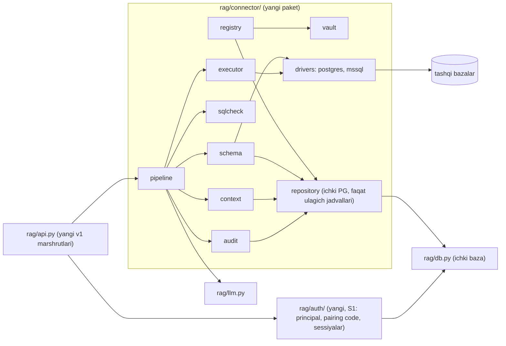
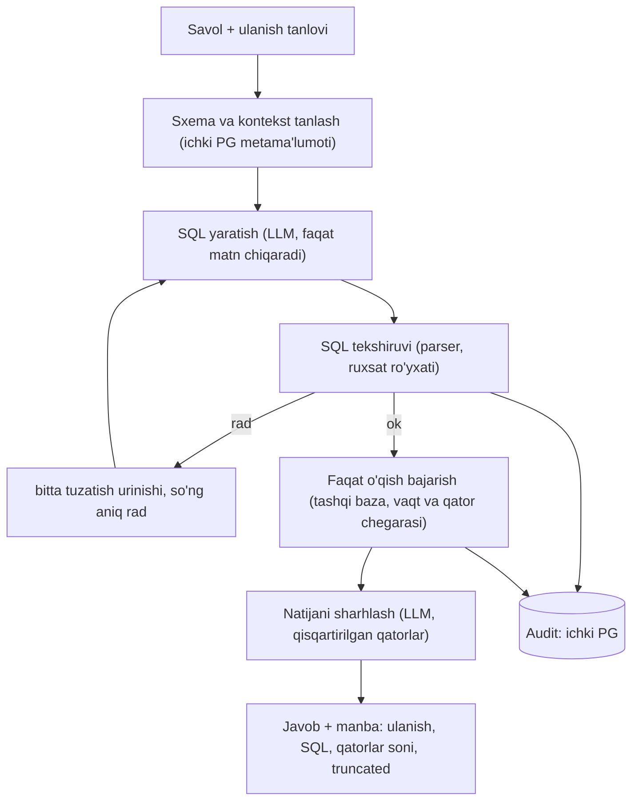

# Arxitektura yo'l xaritasi

Manba: [architecture-audit.md](architecture-audit.md) (topilmalar identifikatorlari shu yerga havola qiladi). Qarorlar: [architecture-decisions.md](architecture-decisions.md).

**Hech bir vazifa tasdiqlanmaguncha amalga oshirilmaydi.** Bu hujjat auditni ko'rib chiqish va keyingi qadamni tanlash uchun.

## 1. Tamoyillar

1. **Saqlash shart bo'lgan kafolatlar** (audit 17-bo'lim): PostgreSQL manba; tekshirilgan faollashtirish; rollback doimiy qaror; qat'iy lease; faol-versiya filtri xavfsiz yopiladi; qayta urinish xavfsiz; faqat qo'shimcha migratsiya. Har vazifaning qabul mezoniga "mavjud testlar o'zgarishsiz o'tadi va baholash natijasi (fayl 97/99/99%, parcha 70/90/93%) o'zgarmaydi" qo'shiladi.
2. **Dalilsiz sifat o'zgartirishi yo'q.** Reranker, gibrid qidiruv, katta model, kvantizatsiya faqat baholashda foyda ko'rsatilsa (va statistik quvvat yetarli bo'lsa, TST-02).
3. **Mikroservis yo'q** (ARC-01) o'lchangan asossiz.
4. **Halokatli migratsiya yo'q**; ustun/indeks olib tashlash alohida tasdiq bilan.
5. **Yangi bog'liqlik yo'q**, aksincha ko'rsatilgan bo'lsa (CI vositalari ilova bog'liqligi emas).

Murakkablik: **S** ≤1 kun, **M** 2–5 kun, **L** >1 hafta. Ustuvorlik **P0** (pilotdan oldin), **P1**, **P2**, **P3** (ko'p foydalanuvchi).

## 2. Bosqichlar va bog'liqliklar

```mermaid
flowchart TD
  subgraph F0["Faza 0: himoya va ko'rinish (P0)"]
    T01["T0.1 Zaxira va tiklash mashqi"]
    T02["T0.2 Reconcile + healthz/status"]
    T03["T0.3 Taraqqiyotga asoslangan timeout"]
    T04["T0.4 LLM chegaralari va bekor qilish"]
    T05["T0.5 Yuklash tanasini erta rad etish"]
    T06["T0.6 UI fokus va a11y"]
  end
  subgraph F1["Faza 1: ishonchlilik va tiklash (P1)"]
    T11["T1.1 Indeks metama'lumoti + reindex"]
    T12["T1.2 Checkpointli indekslash"]
    T13["T1.3 Parser xavfsizligi"]
    T14["T1.4 Silliq to'xtatish"]
    T15["T1.5 API v1 + xato konverti + sahifalash"]
    T16["T1.6 Saqlash siyosati (prune)"]
    T17["T1.7 CI kengaytirish"]
    T18["T1.8 Baholash boshqaruvi"]
    T19["T1.9 Injection chuqurlashtirish"]
  end
  subgraph F2["Faza 2: sifat va tuzilma (P2)"]
    T21["T2.1 Jadvalli PDF tadqiqoti"]
    T22["T2.2 Javob berish signali"]
    T23["T2.3 Token byudjeti"]
    T24["T2.4 Refaktor va tozalash"]
    T25["T2.5 Suhbat"]
    T26["T2.6 Kichik yaxshilanishlar"]
  end
  subgraph F3["Faza 3: ko'p foydalanuvchi (P3)"]
    T31["T3.1 Autentifikatsiya"]
    T32["T3.2 Egalik va izolyatsiya"]
    T33["T3.3 Kvota, cheklov, audit"]
    T34["T3.4 Docker va sirlar"]
    T35["T3.5 To'liq yuk testlari"]
  end
  T01 --> T11
  T02 --> T11
  T02 --> T16
  T03 --> T12
  T04 --> T35
  T05 --> T13
  T15 --> T25
  T18 --> T19
  T18 --> T21
  T18 --> T22
  T18 --> T25
  T11 --> T24
  T15 --> T31
  T31 --> T32
  T32 --> T33
  T13 --> T35
  T34 --> T35
```

Tartib mantig'i: avval **yo'qotib bo'lmaydigan xavflar** (zaxira, jim nomuvofiqlik, hujjatni umuman indekslay olmaslik, LLM osilishi) va foydalanuvchi to'g'ridan-to'g'ri sezadigan nuqsonlar, keyin tiklash/qayta qurish, so'ng sifat va tuzilma, ko'p foydalanuvchi eng oxirida (u oldingi fazalarga tayanadi).

## 3. Faza 0: himoya va ko'rinish (P0)

Bir-biriga bog'liq emas, parallel bajarish mumkin. Taxminiy umumiy hajm: 2–3 hafta.

| ID | Vazifa | Topilma | Mur. | Qabul mezonlari |
|---|---|---|---|---|
| T0.1 | Zaxira va tiklash tartibi + **tiklash mashqi** | DOC-08 | M | `pg_dump` + `storage/` nusxasi + Qdrant snapshot buyruqlari/skripti hujjatlashtirilgan; bo'sh mashinada to'liq tiklash mashqi bajarilgan va natija yozilgan (RPO/RTO); tiklashdan keyin barcha hujjatlar qidiruvda ishlaydi |
| T0.2 | `rag reconcile` (faqat o'qish) + `/healthz`, `/readyz`, `/api/status` | DOC-03, WRK-02 | M | Har `READY` versiya uchun `count_version == chunk_count` va fayl mavjudligi/hashi tekshiriladi; yetim nuqta/fayl hisoboti; test: vektorlarni sun'iy o'chirish hisobotda topiladi; status navbat yoshi, bosqichlar, oxirgi xatolarni ko'rsatadi; yangi bog'liqliksiz |
| T0.3 | Taraqqiyotga asoslangan job timeout, taraqqiyotni DB ga yozish | ING-01, WRK-04 | M | 381 betlik jadvalli byulleten (yoki ekvivalent sintetik) worker orqali muvaffaqiyatli indekslanadi; timeout faqat taraqqiyot to'xtaganda; UI taraqqiyotni (bosqich/sahifa) ko'rsatadi; mavjud timeout testlari o'tadi |
| T0.4 | LLM: so'rov timeouti, `num_predict`, `keep_alive`, mijoz uzilishini aniqlash | LLM-01, LLM-02, LLM-03 | S-M | Mijoz uzilgach LLM 2 s ichida bo'shaydi (E3 tajribasi qayta: keyingi savol kutmaydi); javob uzunligi chegaralangan; sovuq start isitiladi (birinchi token <5 s); Ollama osilganda API 30 s ichida aniq xato beradi |
| T0.5 | Yuklash tanasini `Content-Length` bo'yicha erta rad etish | API-02 | S | E5 tajribasi qayta: limitdan katta tana qabul qilinmaydi, vaqtinchalik papka o'sishi <5 MB |
| T0.6 | UI fokusni saqlash, `aria-label`, `role="alert"`, `aria-live` | API-04 | S-M | e2e: fokus yangilanishdan keyin saqlanadi; savol maydonining kirish nomi bor; xato paneli e'lon qilinadi |

### Bajarilish holati (2026-11-13)

- **T0.1 va T0.2: amalga oshirildi, tasdiq kutilyapti** (commit qilinmagan). Hujjatlar: [backup-restore.md](backup-restore.md), [reconcile-and-status.md](reconcile-and-status.md). Qabul mezonlari natijalari shu hujjatlarda.
- **T0.3 va T0.4: amalga oshirildi, tasdiq kutilyapti** (commit qilinmagan). Hujjatlar: [job-progress.md](job-progress.md), [llm-timeouts.md](llm-timeouts.md). Qabul mezonlari natijalari shu hujjatlarda.
- **T0.5 va T0.6: amalga oshirildi, tasdiq kutilyapti** (commit qilinmagan, 2026-11-16). Hujjatlar: [upload-limits.md](upload-limits.md), [ui-accessibility.md](ui-accessibility.md). Qabul mezonlari natijalari shu hujjatlarda. T0.5 yakunlandi: `Content-Length`siz yuklash 411, jami so'rov ≤ 201 MB, sahifa fayllarni ketma-ket yuboradi (foydalanuvchi qarori); oqimli ko'p qismli tahlil (T1.3) hali bajarilmagan.
- Faza 0 ning T0.1–T0.6 tugagan; qolgan ishlar alohida ruxsat bilan.

## 4. Faza 1: ishonchlilik va tiklash (P1)

Faza 0 dan keyin; taxminan 4–6 hafta.

| ID | Vazifa | Topilma | Mur. | Bog'liq | Qabul mezonlari |
|---|---|---|---|---|---|
| T1.1 | `index_meta` (model, o'lcham, bo'laklash), versiyada `embedded_with`, nomuvofiqlikni rad etish, **`rag reindex`** (yangi kolleksiya, tekshirish, almashtirish) | QDR-01, QDR-02 | L | T0.1, T0.2 | Model o'zgarganda ilova aniq xato bilan to'xtaydi (jim aralashish yo'q); reindex PG+fayllardan to'liq qayta quradi, `reconcile` toza; faol versiya kafolatlari saqlanadi; tiklash mashqi reindex bilan ham o'tadi |
| T1.2 | Partiyalab yuklash va **qayta boshlash nuqtasi** | ING-02 | M | T0.3 | 45-daqiqada o'ldirilgan ish qayta urinishda tugagan bo'laklarni qayta embedding qilmaydi; yakuniy `verify` o'zgarmagan; dublikat nuqta yo'q (mavjud testlar) |
| T1.3 | Sehrli bayt tekshiruvi, zip nisbat/hajm chegarasi, sahifa chegarasi, worker xotira chegarasi | ING-04, ING-03 | M | T0.5 | Zip-bomb va soxta kengaytmali fayl rad etiladi yoki chegarada to'xtaydi; LT-2 (500 000 qatorli xlsx, 2000 betli PDF) chegarada o'tadi |
| T1.4 | Silliq to'xtatish (to'xtash bayrog'i, ishni bo'shatish) | WRK-01 | S-M | | `Supervisor.stop` da joriy ish 5 s ichida qayta navbatga qaytadi (90 s lease kutilmaydi) |
| T1.5 | **API v1**, bitta xato konverti, sahifalash/qidiruv, `If-None-Match`, ichki matnni yashirish | API-01, ARC-06, DB-01, SEC-06 | M | | Eski yo'llar o'tish davrida ishlaydi; UI v1 ga o'tadi; 10 000 hujjatda ro'yxat javobi ≤100 KiB, UI qayta chizish ≤100 ms (LT-3); kontrakt testlari |
| T1.6 | `rag prune` (oxirgi N `SUPERSEDED`, qisman vektorlar, yetim fayllar) | DOC-02, DOC-04 | M | T0.2 | Rollback kafolati saqlanadi (N ichidagi versiyaga qaytish ishlaydi); `reconcile` toza; avtomatik emas, tasdiq bilan |
| T1.7 | CI: kechasi/qo'lda integratsiya va e2e, bog'liqliklar auditi, Dependabot, Action larni SHA bilan qadash, ruff `S` | TST-01, SEC-04 | M | | CI da integratsiya ishi ko'rinadi; zaif bog'liqlik PR da belgilanadi |
| T1.8 | Baholash boshqaruvi: manifest (xesh) va tekshiruv, ≥200 savol, ishonchlilik oralig'i hisobotda | TST-02 | M | | `eval.run` boshida manifest tekshiriladi; hisobotda 95% oraliq; mavjud 78 savol o'zgarmaydi (yangilari alohida to'plam) |
| T1.9 | Injection chuqurlashtirish: hujjat bloklarini ajratish, fayl nomini tozalash, chiqish tekshiruvi; kengaytirilgan injection to'plami | LLM-04 | M | T1.8 | Kengaytirilgan to'plamda (≥40 holat) bajarilmagan ulushi oldingi qiymatdan statistik ishonchli yuqori; hech qachon "yechildi" deb belgilanmaydi |

## 5. Faza 2: sifat va tuzilma (P2)

| ID | Vazifa | Topilma | Mur. | Bog'liq | Qabul mezonlari |
|---|---|---|---|---|---|
| T2.1 | Jadvalli PDF tadqiqoti (alohida tuzilmali chiqarish) | ING-08 | L | T1.8 | Jadval savollari ostidagi alohida to'plamda javob aniqligi ishonchli oshadi; umumiy natija pasaymaydi |
| T2.2 | "Javob berish mumkinmi" signali (reranker bali, nomzod farqi), yolg'on rad etishni kamaytirish | RET-03, LLM-05 | M | T1.8 | Kengaytirilgan to'plamda javobsizlarni to'xtatish ulushi 11% dan ishonchli oshadi, javobli savollarni yo'qotmaydi |
| T2.3 | Kontekst token byudjeti va qisqartirish | LLM-06 | S-M | | Haqiqiy tokenizer bilan maksimum o'lchangan; byudjet oshsa eng past ballli bo'lak tashlanadi; test |
| T2.4 | Xatti-harakatsiz refaktor: `ingest` ni bo'lish, xizmat qatlami, takrorlanishni yo'qotish, tekshiruvli konfiguratsiya, eskirgan izoh/hujjat, eski ustun/indeks migratsiyasi (tasdiq bilan), migratsiya xeshi | ARC-02..05, ARC-07, DOC-07, DB-03 | M-L | T1.1 | Barcha testlar va baholash natijasi o'zgarishsiz; modul xaritasi tsiklsiz qoladi (AST skripti testga aylantirilgan) |
| T2.5 | Suhbat: `conversations`/`messages`, tarix oynasi, savolni qayta yozish | CNV-01 | L | T1.5, T1.8 | Davomli savol ishlaydi; foydasi baholash to'plamida isbotlangan; hujjat/qidiruv holatidan ajratilgan; ADR-P6 tasdiqlangan |
| T2.6 | Kichik yaxshilanishlar: ishni bekor qilish, UI "To'xtatish", `async upload` threadpool, `purge_orphans` kamroq, mutatsiya skripti repoda, qamrov, TST-05 stsenariylari | WRK-03, API-05, API-03, QDR-03, TST-03, TST-06, TST-05, ING-05 | M | | Har biri o'z testi bilan |

## 6. Faza 3: ko'p foydalanuvchi (P3, 3-bosqich)

Darvoza: Faza 0 va Faza 1 tugagan bo'lishi (ayniqsa T0.4, T1.3, T1.5). Avval ADR-P8 tasdiqlanadi.

| ID | Vazifa | Topilma | Mur. | Qabul mezonlari |
|---|---|---|---|---|
| T3.1 | Autentifikatsiya (sessiya/token, parol xeshi) | SEC-01 | L | Avtorizatsiyasiz hech bir endpoint ishlamaydi; CSRF/SameSite siyosati; testlar |
| T3.2 | Egalik (`owner_id`), `(owner_id, name)` noyobligi, NFC nomlar, qidiruv va Qdrant filtrida egasi | SEC-02, DOC-06 | L | Bir foydalanuvchi boshqasining hujjatini topa/o'chira/qaytara olmaydi (izolyatsiya testlari, shu jumladan retrieval) |
| T3.3 | Kvota, tezlik cheklovi, audit jurnali | SEC-05 | M | Kvota oshganda 429; audit jurnalida yuklash/o'chirish/rollback |
| T3.4 | Docker: sirlar, Qdrant API kaliti, resurs chegaralari, dayjest, ilova konteyneri | SEC-03 | M | Standart parol yo'q; konteynerlar chegaralangan; sinalgan joylashtirish |
| T3.5 | To'liq yuk testlari LT-1..6 | PRF-01, PRF-02 | M | Har test o'z qabul chegarasida; natijalar hujjatlashtirilgan; LLM navbati/qurilma qarori (ADR-P2) qayta ko'rilgan |

## 6a. Faza 4: Universal ma'lumotlar bazasi ulagichi (P4, kelajak)

**Holat: faqat reja.** Bu bo'lim kod, migratsiya, bog'liqlik, konfiguratsiya yoki bazaga hech narsa qo'shmaydi va hozirgi amalga oshirish bosqichiga kirmaydi. Qarorlar: [ADR-P12…P16](architecture-decisions.md). Hammasi **Taklif** holatida; tasdiq kerak (8-bo'lim, 6–9-savollar). ADR-P16 umumiy holati **Taklif**; undagi **D-1, D-2, D-3, D-4, D-5, D-7, D-8, D-14 va D-15 (A5 talqini)** hamda **ADR-P16 ning M4.1a scope'iga tegishli qismlari qabul qilingan** (2026-11-17); M4.1b va keyingi bosqich talablari **Taklif**; **D-6, D-9…D-13 va D-16 hal qilinmagan**.

### 6a.1 Darvozalar: bu ishni qachon boshlash mumkin

Faza 4 quyidagilarning **hammasi** bajarilmaguncha boshlanmaydi:

1. **Faza 0 tugagan va qabul qilingan** (T0.1–T0.6; hozir amalga oshirilgan, CI va tasdiq kutilyapti).
2. **Faza 1 (T1.x) to'liq tugagan.**
3. **Arxitektura va ishonchlilik asoslari barqaror:** audit 17-bo'lim kafolatlari mavjud testlar bilan o'zgarishsiz o'tadi; `reconcile` toza; CI (T1.7) yashil; baholash natijasi o'zgarmagan (fayl 97/99/99%, parcha 70/90/93%).

Fazalar tartibida Faza 4 uchinchidan keyin turadi. **D-2 (Qabul qilindi, 2026-11-17):** Faza 3 ning to'liq bajarilishi darvoza **emas**, lekin **M4.1a boshlanishidan oldin** quyidagi zarur qism bajarilishi shart: (1) S1: minimal autentifikatsiya va principal modeli; (2) PostgreSQL uchun non-superuser roli; (3) default va zaif parollarni bartaraf etish, maxfiy ma'lumotlarni xavfsiz saqlash; (4) ishga tushish vaqtidagi xavfsizlik konfiguratsiyasi va readiness tekshiruvlari; (5) ulagich endpointlari uchun principal asosidagi authorization chegarasi. Bular M4.1a ning tarkibi (6a.10a). Faza 3 dan **faqat M4.1a uchun zarur** qism ko'chiriladi; qolgani o'z joyida:

| Faza 3 vazifasi | M4.1a ga ko'chadi | Faza 3 da qoladi |
|---|---|---|
| T3.1 autentifikatsiya | faqat S1: pairing code (bir martalik bootstrap, D-3), xotira sessiyalari (D-4), **faqat ulagich yuzasi** uchun | login, parol xeshi, foydalanuvchi boshqaruvi, cookie/CSRF siyosati, butun API himoyasi |
| T3.2 egalik | faqat `principals` va ulagich jadvallaridagi `owner_principal_id` | hujjat egaligi va izolyatsiyasi, `(owner_id, name)` noyobligi, qidiruv filtri, da'vo oqimi (`users`) |
| T3.3 kvota, tezlik, audit | faqat minimal xavfsizlik hodisalari (6a.10a) | kvota, tezlik cheklovi, hujjat (yuklash/o'chirish/rollback) auditi |
| T3.4 Docker va sirlar | non-superuser rol, tasodifiy parol sirlar faylidan, `.gitignore`, sirlar loyihadan tashqarida, ulagich yoqilganda default parolni rad etish | Qdrant API kaliti (D-13 ochiq), resurs chegaralari, dayjest, ilova konteyneri, butun loyiha bo'yicha standart parollarni bartaraf etish |
| T3.5 yuk testlari | | to'liq |

Butun loyiha uchun to'liq autentifikatsiya tizimi bu qarorga **kirmaydi**. Yo'l xaritasining Faza 3 bo'limi matni o'zgartirilmagan: ko'chirish faqat shu yerda qayd etilgan. **D-1 (Qabul qilindi, 2026-11-17):** yangi ulagich endpointlari autentifikatsiya bilan himoyalanadi, mavjud hujjat va `ask` endpointlari ADR-007 doirasida qoladi va xatti-harakati o'zgarmaydi; bu ikki darajali model **vaqtinchalik**, yagona modelga o'tish alohida qaror va bosqich. ADR-007 matni o'zgarmaydi. M4.0 (tadqiqot) va M4.4 (`sqlcheck`, hisob ma'lumotisiz) M4.1a ga bog'liq emas. M4.1a security gate **yopilgan: Ready for implementation** (6a.10a); kod yozish alohida tasdiq talab qiladi.

### 6a.2 Maqsad

Local RAG Assistant ixtiyoriy tashqi loyihalarning bazalariga (boshlang'ich: **PostgreSQL**, **Microsoft SQL Server**) ulanib, foydalanuvchi savoliga o'sha bazadagi ma'lumot asosida javob beradi: savol → sxema/kontekst → SQL → tekshiruv → **faqat o'qish** bajarish → sharhlash → manba (ulanish va SQL) bilan javob. Boshqa dvigatellar (MySQL, Oracle va h.k.) keyin qo'shiladi; MVP shu uchun ortiqcha abstraksiyasiz, torg'ina interfeys qoldiradi.

### 6a.3 Qamrov va qamrovdan tashqari

| Qamrovda (MVP) | Qamrovdan tashqari |
|---|---|
| Bir nechta ulanishni ro'yxatdan o'tkazish va boshqarish | Tashqi bazaga **yozish**, sxemani o'zgartirish, saqlangan protsedura chaqirish |
| Sxema aniqlash (jadval, ko'rinish, ustun, kalit, bog'lanish) | Tashqi ma'lumotni ichki bazaga nusxalash (ETL, replikatsiya, keshlash) |
| Biznes kontekst (tavsif, atama, qoida) | Bazalararo birlashtirish (cross-database join) |
| Tabiiy tildan SQL ga (faqat `SELECT`), tekshiruv, cheklovli bajarish | NoSQL, grafik yoki fayl "bazalar" |
| Audit, ulanish holati | BI paneli, diagramma, rejalashtirilgan hisobot |
| (Kelajak, alohida bosqich) Hujjat RAG + baza RAG | Foydalanuvchi boshqaruvi va ulanish egaligi (Faza 3 ishi) |

### 6a.4 Ikki bazani qat'iy ajratish

Bu muhim arxitektura talabi. Ikki toifa hech qachon aralashmaydi.

| | **Ichki ilova bazasi** | **Tashqi loyiha bazalari** |
|---|---|---|
| Egasi | Local RAG Assistant | Foydalanuvchining boshqa ilovalari |
| Mazmun | hujjatlar, versiyalar, job lar, metama'lumot, audit, ilova holati; (kerak bo'lsa) foydalanuvchi/konfiguratsiya; **ulagichning o'z holati**: ulanish yozuvlari, sxema snapshoti, biznes kontekst, so'rov auditi | ularning o'z ma'lumotlari |
| Rol | ilovaning yagona haqiqat manbai (ADR-002) | tashqi manba; faqat ulagich orqali **o'qiladi** |
| Ulanish | `rag.db` puli (`RAG_DATABASE_URL`, `DB_POOL_SIZE=5`) | har ulanish uchun **alohida** pul, `rag.db` dan mustaqil |
| O'zgartirish | ilova migratsiyalari (faqat qo'shimcha, ADR-011) | **hech qachon**: ulagich sxema yoki ma'lumotni o'zgartirmaydi |

Qoidalar: (1) tashqi baza hech qachon ichki ilovaning saqlash vazifasini bajarmaydi (job, versiya, audit, holat u yerga yozilmaydi); (2) ichki baza hech qachon "tashqi manba" sifatida ro'yxatdan o'tkazilmaydi (ulagich `RAG_DATABASE_URL` ning o'zini yoki shu serverdagi ichki sxemani rad etadi, 6a.6 SR-9); (3) tashqi bazaning **ma'lumoti** ichki bazaga nusxalanmaydi; ichkida faqat **metama'lumot** (nomlar, turlar, kalitlar) va foydalanuvchi yozgan kontekst saqlanadi.

### 6a.5 Funksional talablar

**Ulanishlarni boshqarish (FR-1)**
- Bir nechta ulanish; nom (noyob), tavsif, dvigatel tanlash (`postgresql`, `mssql`); host, port, baza, TLS parametrlari.
- Hisob ma'lumotini xavfsiz saqlash (ADR-P14, ADR-P16): shifrlangan, bog'lovchi ma'lumot = `connection_id` + `key_id` (egasi emas); **faqat yoziladi, qaytarilmaydi**; yaratish/o'zgartirish step-up (yangi bootstrap) talab qiladi. Har ulanishning egasi `owner_principal_id`.
- Ulanish sinovi: ulanadi, `SELECT 1`, versiya, va **foydalanuvchida yozish huquqi borligini aniqlab ogohlantiradi** (6a.6 SR-3).
- Yoqish/o'chirish (o'chirilgan ulanishga savol berilmaydi, puli yopiladi); yangilash; o'chirish (puli yopiladi; kontekst va audit siyosati OQ-7).
- Holat va oxirgi muvaffaqiyatli ulanish vaqti; oxirgi xato kodi (matni emas).

**Sxema aniqlash (FR-2)**
- Metama'lumot: sxemalar, jadvallar, ko'rinishlar, ustun nomi va turi, nullable, birlamchi/tashqi kalit, bog'lanishlar.
- Yangilash (qo'lda; ixtiyoriy rejalashtirilgan), o'zgarishni aniqlash (qo'shilgan/olib tashlangan/turi o'zgargan) va **eskirgan kontekst** belgisi.
- Foydalanuvchi qaysi sxema/jadval/ustun yordamchiga **ochiq** ekanini tanlaydi (standart: hech narsa ochiq emas). Ustunni "yashirin" deb belgilash mumkin (SQL ga ham, natijaga ham kirmaydi).
- Ma'lumot qatorlari nusxalanmaydi.

**Biznes kontekst (FR-3)**
- Jadval, ustun, bog'lanish tavsifi; biznes atamalari (lug'at); muhim filtrlar va biznes qoidalar (masalan, "faol mijoz = `status='A'`"); ixtiyoriy namunaviy savol→SQL juftliklari (M4.6 da baholab qo'shiladi).
- Ichki bazada saqlanadi; model uchun prompt ga **ma'lumot** sifatida kiradi, ko'rsatma sifatida emas (SR-8).

**Tabiiy tildan SQL ga (FR-4)**
- Quvur: savol → sxema/kontekst tanlash → SQL yaratish → **SQL tekshiruvi** → faqat o'qish bajarish → natijani sharhlash → javob (manba: ulanish nomi, tekshirilgan SQL, qatorlar soni, `truncated`, davomiylik).
- Tekshiruv rad etsa: modelga xato bilan **bitta** tuzatish urinishi, keyin aniq rad (hech qachon tekshirilmagan SQL bajarilmaydi).

**Audit va kuzatuv (FR-5)**
- Har so'rov: kim boshlagan (`principal_id`, ADR-P16), qaysi ulanish, davomiylik, qatorlar soni, holat (muvaffaqiyat/xato kodi) doim; tabiiy til savoli va **tekshirilgan** SQL **rejimga ko'ra** (`minimal`/`redacted`/`full`, SR-14; standart va muddatlar D-10). Natija ma'lumoti, parol, token yozilmaydi.

### 6a.6 Xavfsizlik talablari

- **SR-1. Faqat `SELECT`** (va `WITH … SELECT`). `INSERT`, `UPDATE`, `DELETE`, `MERGE`, `DROP`, `ALTER`, `TRUNCATE`, `CREATE`, `GRANT`/`REVOKE`, `EXEC`/`EXECUTE`, `CALL`, `COPY`, `SET` va boshqa yozuvchi/ma'muriy amallar rad etiladi.
- **SR-2. Tuzilma bo'yicha tekshiruv, kalit so'z bo'yicha emas:** SQL dvigatel lahjasi bilan **tahlil qilinadi** (parser, AST). Tekshiriladi: bitta ifoda (ko'p ifodali bajarish yo'q); ildiz `SELECT`; ma'lumotni o'zgartiruvchi CTE yo'q (`WITH x AS (DELETE … RETURNING …)`); `SELECT … INTO` (T-SQL jadval yaratadi) yo'q; qulflovchi bandlar yo'q (`FOR UPDATE`); xavfli funksiyalar yo'q (masalan `pg_sleep`, `pg_read_file`, `lo_import`, `dblink`; `xp_cmdshell`, `OPENROWSET`, `OPENQUERY`, `OPENDATASOURCE`, `WAITFOR`); havola qilingan jadval/ko'rinishlar **tanlangan (ochiq) ro'yxatda**; tizim katalogi (`pg_catalog`, `information_schema`, `sys.*`) ruxsatsiz yopiq. Tahlil qilib bo'lmaydigan SQL rad etiladi (fail-closed).
- **SR-3. Faqat o'qish hisob ma'lumoti: chuqurlashtirilgan himoya (defense-in-depth), SQL tekshiruvining o'rnini bosmaydi.** Ikkalasi ham kerak. Ulanish sinovi yozish huquqini aniqlasa ogohlantiradi (qat'iy rad etishmi, OQ-4). Seans darajasida: PostgreSQL `default_transaction_read_only`/`READ ONLY` tranzaksiya; SQL Server da seans darajasidagi read-only yo'q, shuning uchun u yerda faqat hisob huquqlari va tekshiruv himoya qiladi.
- **SR-4. Vaqt chegarasi:** har so'rov uchun server tomonida (`statement_timeout`; SQL Server so'rov timeouti + `LOCK_TIMEOUT`) va ilova tomonida; chegaradan oshganda so'rov **tashqi serverda ham bekor qilinadi** (faqat mijoz kutishni to'xtatishi yetarli emas).
- **SR-5. Qator chegarasi (sozlanadigan):** SQL ga chegara kiritiladi (`LIMIT`, `TOP`/`OFFSET…FETCH`) **va** kursor darajasida ham qat'iy yuqori chegara (ya'ni model chegarasiz SQL yozsa ham xotira o'smaydi); kesilsa `truncated=true`.
- **SR-6. SQL in'ektsiya:** model SQL ni ilova matn biriktirib yasamaydi; ilovaning o'z metama'lumot so'rovlari parametrlangan; foydalanuvchi savoli hech qachon SQL satriga biriktirilmaydi; yaratilgan SQL har doim **ishonchsiz kirish** hisoblanadi va faqat tekshiruvdan o'tgach bajariladi. Model yaratgan SQL **hech qachon tekshiruvsiz bajarilmaydi.**
- **SR-7. Hisob ma'lumoti hech qachon** API javobi, jurnal, UI, xato matni, zaxira manifesti yoki audit yozuvida chiqmaydi. Drayver istisnolari (ulanish matnini o'z ichiga olishi mumkin) kodga aylantiriladi, matni tozalanadi.
- **SR-8. Prompt-injection:** sxema nomlari, ustun izohlari, biznes kontekst va **natija qatorlari** ishonchsiz matn (ADR-P9, T1.9): aniq ajratuvchilar, "ma'lumot, ko'rsatma emas", natija hajmi va ustun qiymati uzunligi chegaralanadi. Modelning chiqishi bajariladigan kod bo'lgani uchun bu xavf hujjat RAG dagidan yuqori.
- **SR-9. Ichki bazani himoya:** ulagich `RAG_DATABASE_URL` ni (host, port, baza va sxema bo'yicha) tashqi ulanish sifatida rad etadi; tashqi pul `rag.db` pulidan hech qachon ulanish olmaydi.
- **SR-10. Tarmoq:** host/port ruxsat siyosati (OQ-9); loopbackdan tashqari ulanishda TLS standart bo'yicha majburiy (sertifikat tekshiruvi; o'chirish aniq tasdiq bilan).
- **SR-11. Autentifikatsiya chegarasi va haqiqiy xavfsizlik chegarasi** (ADR-P16 P16.1–P16.4; D-1, D-3, D-4). Ulagich marshrutlari tokensiz 401. Bootstrap: **bir martalik pairing code** (CSPRNG, qisqa muddat, urinishdan keyin yaroqsiz, rate limit; URL, jurnal va repoga yozilmaydi); **pairing code session token emas** (faqat almashtirish uchun). Sessiyalar faqat server xotirasida: mutlaq umr 12 daqiqa, bo'sh turish 2 daqiqa, step-up oynasi 10 daqiqa, mutlaq umrdan oshmaydi (D-4; vaqtni server tekshiradi; restartda bekor; rotation va revocation bor); brauzerda faqat `sessionStorage` (cookie va `localStorage` yo'q); `Referrer-Policy: no-referrer`; hisob ma'lumoti o'zgarishi step-up bilan. **E'lon qilingan chegara:** loopback OS-foydalanuvchi chegarasi emas (WSL2, konteynerlar yetib boradi), Docker kirishi ma'mur darajasiga teng, shu OS-foydalanuvchi zararli dasturi himoya doirasidan **tashqarida**. Faqat ulagich yuzasi himoyalanadi (D-1).
- **SR-12. Ichki DB qattiqlashtirish va uzluksiz tayyorlik** (P16.5; D-7, D-15): alohida ilova roli, superuser emas (va `CREATEROLE`, `CREATEDB`, `REPLICATION`, `BYPASSRLS` yo'q), minimal privilege; kuchli tasodifiy (≥128 bit) credential sirlar faylidan, Docker image va repoda emas; ishga tushishda rol va privilege tekshiruvi; credential rotation runbooki; migratsiya uchun alohida rol ixtiyoriy (runtime roli DDL huquqisiz); `.gitignore` da `.env` va sirlar; Qdrant API kaliti (D-13 ochiq). `RAG_CONNECTOR_ENABLED` standart o'chiq; **default credential ni rad etish va tayyorlik shartlari faqat `RAG_CONNECTOR_ENABLED=true` bo'lganda majburiy (D-15)**; o'chiq rejimda mavjud tizim xatti-harakati o'zgarmaydi; yoqilganda shart buzilsa `/readyz` "tayyor emas" va ulagich 503 `connector_unavailable` (fail-closed). Ilova parol **kuchini** tasdiqlay olmaydi, faqat evristik tekshiradi.
- **SR-13. Kalit, shifr va zaxira** (P16.3, P16.8; D-8): AAD = `connection_id` + `key_id` (egasi emas); shifrlash kaliti PostgreSQL da, zaxirada, repoda va Docker image da emas; kalit uchun alohida recovery/backup siyosati, recovery nusxasi asosiy kalitdan alohida himoyalanadi; kalit yo'qolsa credential lar tiklanmasligi mumkinligi ochiq hujjatlashtiriladi (`needs_credentials`); rotation va recovery `key_id` versiyalanishi bilan mos; T0.1 zaxirasi shifrmatnni oladi, kalitni olmaydi; `connector verify` faqat o'qish (M4.1b).
- **SR-14. Audit maxfiyligi** (P16.7): metama'lumot doim, matnli maydonlar rejim bilan (`minimal`/`redacted`/`full`; `redacted` da literallar parser bilan almashtiriladi, tahlil muvaffaqiyatsiz bo'lsa xom SQL saqlanmaydi); saqlash muddati va tozalash tasdiq bilan; faqat egasi o'qiydi; o'chirish "qabr toshi"; jurnal faqat ruxsat etilgan maydonlar, tashqi drayver istisnolari kodga aylantiriladi.
- **SR-15. Pairing code ni yetkazish va ko'rsatish** (P16.4 band 2; D-3): kod faqat ilova jarayonining o'z konsoliga chiqadi; URL, buyruq satri argumenti, fayl, xabarnoma, clipboard va brauzer tarixi orqali yetkazilmaydi; konsol chiqishi jurnalga yoki faylga yo'naltirilmaydi; yaratish va so'rov tezligi hamda faol kodlar soni cheklangan; kiritish maydoni faqat ulagich bo'limida, `autocomplete="off"`, kiritilgach tozalanadi. Qoldiq xavf: konsolni ko'ra oladigan shaxs yoki jarayon.
- **SR-16. Sir fayllari joyi** (P16.4 band 6; D-5): repozitoriydan tashqarida; Windows da `%LOCALAPPDATA%` ostidagi ilovaga xos katalog; fayl va katalog ACL bilan faqat tegishli OS-foydalanuvchiga; sirlar repoda, jurnalda, Docker image da va oddiy konfiguratsiya fayllarida yo'q; WSL2 yoki boshqa runtime da haqiqiy ruxsat/ACL xatti-harakati alohida tekshiriladi; kafolatlab bo'lmasa fail-closed.
- **SR-17. Xavfsizlik hodisalari jurnali (M4.1a)** (P16.7; D-14): alohida himoyalangan log fayli, repozitoriydan tashqarida, yozish huquqi cheklangan; sir, parol, token, pairing code, shifrlash kaliti, SQL literal, xom so'rov va foydalanuvchi maxfiy ma'lumoti **yozilmaydi**; xom istisno/stack trace ichidagi sezgir ma'lumot chiqmaydi (kodga aylantiriladi); rotation va retention siyosati hujjatlashtiriladi; yozish xatosi security-critical hodisalarni jim yo'qotmaydi; keyin saqlashni PostgreSQL yoki boshqasiga ko'chirish alohida qaror. So'rov auditi (M4.5) saqlash joyi bunga kirmaydi (ADR-P14, D-10).

### 6a.7 Modul chegaralari

Modulli monolit (ADR-001), mikroservis yo'q. Yangi paket `rag/connector/` (hozir mavjud emas). Hozirgi qatlamlash (audit E9): `config` (barg) → `db/store/llm/storage/…` → `ingest/answer/versioning` → `api/worker`. Ulagich shu xaritaga **yon tarmoq** sifatida qo'shiladi, mavjud modullarga bog'lanmaydi.

| Qism | Vazifa |
|---|---|
| `registry`, `vault` | ulanish yozuvlari (CRUD, holat), hisob ma'lumotini shifrlash/ochish |
| `drivers` | har dvigatel uchun adapter: `connect`, `introspect`, `execute_readonly`, `cancel`; dvigatel nomi bo'yicha ro'yxat (registry), fabrika/meta-sinfsiz |
| `schema` | aniqlash, yangilash, snapshot, ochiq ob'ektlar tanlovi |
| `context` | biznes kontekst, prompt uchun tanlash (token byudjeti) |
| `sqlcheck` | lahjali parser, ruxsat ro'yxati (SR-1, SR-2); sof funksiya, tarmoqsiz va bazasiz, shuning uchun to'liq unit-testlanadi |
| `executor` | chegaralar (SR-4, SR-5), bekor qilish, pul |
| `pipeline` | quvur orkestratsiyasi; modelga faqat `llm` orqali chiqadi |
| `audit` | so'rov yozuvi |
| `repository` | **yagona** joy: ichki bazaga tegadi (faqat ulagichning o'z jadvallari); har so'rovda `owner_principal_id` bo'yicha filtrlaydi |
| `rag/auth/` (ulagich paketidan **tashqarida**, ilova darajasida) | S1: `principals`, pairing code (bir martalik bootstrap) va xotira sessiyalari, `current_principal`, `authorize`; ichki bazaga o'z jadvali orqali tegadi. Ulagich unga bog'lanmaydi: `api` principal id ni ulagichga parametr sifatida beradi (ADR-P16) |

Majburiy chegara qoidalari (AST testi bilan, E9 skripti kabi, testga aylantiriladi):
1. Ulagich `ingest`, `store`, `versioning`, `worker`, `storage`, `answer` ni **import qilmaydi**; ular ulagichni import qilmaydi. Faqat `api` ulaydi.
2. `drivers` ichida `rag.db` importi yo'q; ichki bazaga faqat `repository` tegadi.
3. Hujjat RAG yo'li (`answer.retrieve`, Qdrant `documents` kolleksiyasi, `active_version_ids`) **o'zgarmaydi**; audit 17-bo'lim kafolatlari buzilmaydi.
4. Yangi bog'liqliklar (SQL parser, SQL Server drayveri, shifrlash) faqat ulagichda, **lazy** import va ixtiyoriy requirements fayli bilan; yengil API va CI (faqat core+dev) buzilmaydi (OQ-5).
5. Ulagich `rag/auth/` ni import qilmaydi; `api` principal id ni parametr sifatida uzatadi. `drivers` hech qachon `rag.db` yoki `rag/auth/` ni import qilmaydi.

Ichki bazadagi yangi ob'ektlar (kontseptual, DDL Faza 4 da, **faqat qo'shimcha migratsiya**, ADR-011): `principals` (S1, yagona `local-owner` qatori, takroran xavfsiz seed), ulanish yozuvlari (hisob ma'lumoti shifrlangan: `ciphertext`, `nonce`, `key_id`; `owner_principal_id uuid NOT NULL REFERENCES principals(id)`; **`owner_id='local'` matni yo'q**), sxema snapshoti, kontekst, so'rov auditi (`principal_id` ga murojaat). Hujjat/versiya/job jadvallari o'zgarmaydi.

### 6a.8 Yuqori darajali ma'lumotlar oqimi

MVP da ulanishni foydalanuvchi tanlaydi (avtomatik yo'naltirish keyin, 6a.12). Sxema katta bo'lsa tanlash: nom/tavsif bo'yicha leksik moslik + tashqi kalit grafida qo'shni jadvallarni kengaytirish; embedding (alohida **hosila** Qdrant kolleksiyasi, hujjat kolleksiyasidan ajratilgan, ichki PG dan qayta quriladigan, ADR-002 ga mos) faqat baholashda foyda ko'rsatilsa (tamoyil 2).

### 6a.9 Ulanish hayot sikli, pul, bekor qilish va parallellik

- **Pul:** har ulanishga kichik alohida pul (standart 1–3, sozlanadi), dangasa ochiladi, bo'sh turganda yopiladi; yoqilmagan/o'chirilgan/o'zgartirilgan/o'chirilgan ulanish va ilova to'xtashida (T1.4) yopiladi. Global yuqori chegara: bir vaqtda tashqi so'rovlar soni.
- **Bekor qilish:** mijoz uzilganda yoki timeout bo'lganda tashqi so'rov dvigatel vositasi bilan to'xtatiladi (PostgreSQL bekor qilish so'rovi, SQL Server drayver bekor qilishi); T0.4 dagi bekor qilish naqshi (`llm.Scope`, `relay`) g'oyasi qayta ishlatiladi, kodi emas.
- **Parallellik:** tashqi so'rovlar alohida, chegaralangan ijrochi oqimlarda; sekin tashqi baza FastAPI umumiy thread-poolini (hujjat ro'yxati va h.k. ishlatadi) to'ldirib qo'ymasligi kerak (R-9). LLM yo'li Ollama da ketma-ket (ADR-P2): bitta savol **ikki** LLM chaqiruvi (SQL va sharh) oladi, shuning uchun kutish ikki barobar (R-2).
- **Xatolarda:** ketma-ket muvaffaqiyatsizlikda qisqa kutib qayta urinish (backoff), holat "nosoz"; xato kodi UI da aniq.

### 6a.10 Taklif etilgan bosqichlar (milestones)

| # | Bosqich | Natija | Mur. |
|---|---|---|---|
| M4.0 | **Tadqiqot va asos** (kod emas, yoki tashlab yuboriladigan skript) | Namuna bazalar (PG va SQL Server, kichik sintetik sxema); `qwen2.5:7b` ning SQL yaratish **boshlang'ich aniqligi** o'lchanadi; ADR-P12…P16 va qolgan ochiq qarorlar (D-6, D-9…D-13, D-16) mahsulot egasi tomonidan ko'rib chiqiladi (D-1…D-5, D-7, D-8, D-14, D-15 qabul qilingan); yangi bog'liqliklar tasdiqi | M |
| M4.1a | **S1 chegarasi va ichki DB qattiqlashtirish** (D-2: hisob ma'lumoti saqlanishidan **oldin**; aniq chegara: 6a.10a) | principal modeli (`rag/auth/`, `principals`, `local-owner`), S1 autentifikatsiya (pairing code bilan bir martalik bootstrap, xotira sessiyalari 12/2/10 daqiqa, rotation va revocation), ulagich endpointlari uchun authentication va `authorize`, non-superuser ilova roli va default/zaif parolni rad etish (faqat ulagich yoqilganda), sirlar va kalit joyi loyihadan tashqarida (D-5, D-8), `RAG_CONNECTOR_ENABLED` fail-closed va uzluksiz tayyorlik tekshiruvi, da'vo uchun sxema shartlari, xavfsizlik hodisalari himoyalangan log faylida (D-14). **Hisob ma'lumoti saqlash/shifrlash, tashqi ulanish va SQL yo'q** | M |
| M4.1b | Ulanishlar (M4.1a ga tayanadi) | `connector` skeleti, ulagich jadvallari (`owner_principal_id`), `vault` (AAD = `connection_id + key_id`, kalit tashqarida), ulanishlar CRUD + sinov + holat (step-up bilan), `connector verify` (shifrmatnni ochish tekshiruvi), PostgreSQL adapteri; UI | L |
| M4.2 | Sxema aniqlash | PG va SQL Server adapteri, snapshot, yangilash, ochiq ob'ektlarni tanlash | M |
| M4.3 | Biznes kontekst | kontekst CRUD, prompt yig'ish token byudjetida | M |
| M4.4 | **SQL tekshiruvi (bajaruvchidan oldin)** | `sqlcheck` + dushmanona to'plam; bu bosqich tugamaguncha hech qanday tashqi SQL bajarilmaydi | M |
| M4.5 | Faqat o'qish bajaruvchi | chegaralar, bekor qilish, pul, audit | L |
| M4.6 | Quvur va baholash | NL→SQL oxirigacha, UI, baholash to'plami (T1.8 manifesti), xavfsizlik va yuk testlari | L |
| M4.7 | (Kelajak) Gibrid RAG | 6a.12 | L |

M4.1a tugamaguncha **hech qanday tashqi hisob ma'lumoti saqlanmaydi**. M4.0 va M4.4 (`sqlcheck`, hisob ma'lumotisiz sof funksiya) M4.1a ga bog'liq emas.

### 6a.10a M4.1a va M4.1b chegaralari, M4.1a security gate (D-1, D-2, D-3…D-5, D-7, D-8, D-14, D-15)

**M4.1a security gate: Ready for implementation (2026-11-17).** Quyidagilarning hammasi hujjatlarda izchil qayd etilgan:

| Shart | Holat |
|---|---|
| D-1 ikki darajali API yuzasi | qabul qilindi |
| D-2 Faza 3 ning zarur qismini ko'chirish | qabul qilindi |
| D-15 (A5): default credential faqat `RAG_CONNECTOR_ENABLED=true` da | qabul qilindi |
| D-3 bootstrap usuli | qabul qilindi: bir martalik pairing code |
| D-4 sessiya parametrlari | qabul qilindi, **yakuniy**: mutlaq 12 daqiqa, bo'sh turish 2 daqiqa, step-up 10 daqiqa (daqiqalarda, soat emas; step-up mutlaq umrdan oshmaydi) |
| D-5 sir saqlash joyi | qabul qilindi |
| D-7 PostgreSQL rol modeli | qabul qilindi |
| D-8 kalit saqlash va recovery | qabul qilindi |
| D-14 xavfsizlik hodisalari joyi | qabul qilindi: himoyalangan log fayli |
| ADR-P16 ning M4.1a uchun zarur bandlari | qabul qilindi **faqat M4.1a scope'i**: P16.1; P16.2 (S0, S1); P16.3 (principal, `authorize`, claim-not-remap tamoyili); P16.4 (4-bandning hisob ma'lumotiga qo'llanishi va 7-banddan tashqari); P16.5 (R5 va ta'minot buyrug'idan tashqari); P16.6 (faqat sxema shartlari va compare-and-set sinovi); P16.7 (faqat xavfsizlik hodisalari). ADR-P16 umumiy holati **Taklif** |

**Bu implementatsiyani boshlash uchun avtomatik ruxsat emas:** kod yozish alohida tasdiq talab qiladi. Gate faqat M4.1a ga tegishli; M4.1b, M4.5 va Faza 3 talablari **Taklif** bo'lib qoladi. M4.1a loyihalashida (qabul qilingan cheklovlar doirasida) belgilanadigan parametrlar: pairing code uzunligi/alfaviti/muddati/urinishlar chegarasi, xavfsizlik jurnali rotation va retention qiymatlari, migratsiya rolini ajratish-ajratmaslik, ta'minot buyrug'i shakli.

**Gate ni bloklamaydigan, lekin keyingi bosqichlarga ta'sir qiladigan ochiq qarorlar** (D-6, D-9…D-13, D-16 M4.1a boshlanishini bloklamaydi):

| Qaror | M4.1a ga ta'siri | Keyingi bosqichlarga ta'siri |
|---|---|---|
| D-6 S1 qamrovi | yo'q (D-1 bilan M4.1a faqat ulagich yuzasini qamraydi) | butun APIga kengaytirish kelajakdagi alohida qaror (S2/Faza 3) |
| D-9 da'vodan keyingi kirish | yo'q | Faza 3 (da'vo oqimi); M4.1b ga ta'siri yo'q |
| D-10 audit rejimi va muddatlar | yo'q (xavfsizlik hodisalari D-14 bilan) | **M4.5** (so'rov auditi); M4.1b ga ta'siri yo'q |
| D-11 o'chirishda audit siyosati | yo'q | **M4.1b** ulanishni o'chirish semantikasiga (keyingi jadvallarga bog'lanish) ta'sir qilishi mumkin; M4.3/M4.5 |
| D-12 hujjat egaligi | yo'q | Faza 3 (T3.2); Faza 4 ga ta'siri yo'q |
| D-13 Qdrant API kaliti | yo'q | faqat hosila sxema embeddingi yoziladigan bo'lsa (M4.2/M4.3 dan keyin) |
| D-16 brauzersiz mijozlar uchun kirish | yo'q (pairing code ikkala turga ham ishlaydi) | .NET/skript mijozlari uchun alohida qaror |

**Kiradi (in scope)**
- **Local principal modeli:** `principals`, yagona `local-owner` (qo'shimcha migratsiya, takroran xavfsiz seed, barqaror id), `current_principal`.
- **S1 minimal autentifikatsiya:** faqat ulagich yuzasi uchun (D-1).
- **Bir martalik bootstrap (pairing code, D-3) va xotira sessiyalari (D-4):** P16.4 bo'yicha xavfsiz arxitektura va amalga oshirish; pairing code session token emas; sessiyalar faqat server xotirasida (mutlaq 12 daqiqa, bo'sh turish 2 daqiqa, step-up 10 daqiqa va u mutlaq umrdan oshmaydi, server tekshiradi, restartda bekor); brauzerda faqat `sessionStorage`; rotation va revocation; pairing code ni yetkazish talablari (SR-15). Brauzer tomonida faqat **minimal kod kiritish oynasi** ulagich bo'limida; ulanishlar UI si M4.1b.
- **Ulagich endpointlari uchun authentication va authorization:** `authorize(principal, action, resource)` yagona nuqta. M4.1a endpointlari faqat: pairing code almashtirish, sessiya holati/bekor qilish, ulagich holati (tayyorlik sabab kodlari bilan). Ulanish CRUD **yo'q**.
- **PostgreSQL non-superuser konfiguratsiyasi** (D-7, P16.5): alohida ilova roli, minimal privilege, ishga tushishda tekshiruv, rotation runbooki; migratsiya roli ixtiyoriy.
- **Default va zaif credential larni bartaraf etish** (D-15): ulagich yoqilganda ma'lum standart parolni va superuser rolni rad etish; kuchli parol ta'minot talabi (ilova faqat evristik tekshiradi).
- **Sir fayllari va kalit joyi loyihadan tashqarida** (D-5, D-8): joy qoidasi, ACL/ruxsat tekshiruvi (fail-closed), `.gitignore` qoidalari. Kalitning o'zidan foydalanish va recovery vositalari M4.1b da.
- **Startup/readiness security checks** (P16.5): ishga tushishda, `/readyz` va `/api/status` da, ulagich so'rovidan oldin ≤60 s kesh; **faqat `RAG_CONNECTOR_ENABLED=true`** bo'lganda (D-15).
- **Birinchi admin da'vosi uchun arxitekturaviy shartlar:** `principals` da `user_id` (NULL) va `claimed_at` ustunlari, `kind='local-owner'` uchun noyob qisman indeks, compare-and-set (`UPDATE … WHERE kind='local-owner' AND user_id IS NULL`) ning DB darajasidagi sinovi (claim, not remap). Da'vo oqimi va `users` jadvali M4.1a da **yo'q** (Faza 3).
- **Xavfsizlik hodisalari jurnali (D-14, SR-17):** alohida himoyalangan log fayli; hodisalar: pairing code almashtirish (muvaffaqiyat/rad), sessiya yaratish/bekor qilish/aylantirish, tayyorlik sharti buzilishi o'tishlari; maydonlar: vaqt, hodisa turi, `principal_id` (ma'lum bo'lsa), natija/sabab kodi; sir, kod, token, kalit, SQL literal va xom istisno **yo'q**; rotation/retention hujjatlashtiriladi.

**Kirmaydi (out of scope)**
- Multi-user funksionalligini to'liq amalga oshirish; foydalanuvchilar, login, parol xeshi, foydalanuvchi boshqaruvi, rol/ruxsat tizimi.
- Mavjud barcha API endpointlarini autentifikatsiyaga o'tkazish (D-1: ular ADR-007 doirasida va o'zgarmaydi).
- Hujjat egaligi va izolyatsiyasi (`documents.owner_id`, D-12, T3.2).
- Uzoq muddatli mahalliy sir fayli (D-16, ochiq).
- Ulagichning SQL yaratish va bajarish funksionalligi (M4.4–M4.6), tashqi bazaga ulanish kodi (`drivers`).
- Hisob ma'lumotini shifrlash va saqlash: `vault`, AAD = `connection_id` + `key_id`, kalit recovery vositalari va aylantirish, ulagich jadvallari, ulanishlar CRUD, `connector verify` shifrmatn tekshiruvi, ulagich jadvallaridagi `owner_principal_id` va `repository` egasi filtri, step-up ni hisob ma'lumotini yaratish/o'zgartirishga qo'llash: **M4.1b**.
- Faza 3 ning qolgan vazifalari (kvota, tezlik cheklovi, hujjat auditi, Docker qattiqlashtirishning qolgani, Qdrant API kaliti D-13, yuk testlari).

**M4.1b chegarasi.** M4.1b M4.1a ga tayanadi va ADR-P16 talablarini saqlaydi: shifr bog'lovchi ma'lumoti `connection_id` + `key_id` (egasi emas), shifrlash kaliti PostgreSQL dan, zaxiradan, repoga va Docker image dan tashqarida (P16.3, P16.8, D-8), hisob ma'lumoti faqat yoziladi va uni o'zgartirish step-up talab qiladi. Bular M4.1a ga kirmaydi va M4.1a bilan aralashtirilmaydi.

### 6a.11 Qabul mezonlari

1. **Ajratish:** AST testi 6a.7 qoidalarini tekshiradi; tashqi ulanish `RAG_DATABASE_URL` ni rad etadi; audit 17-bo'lim kafolatlari testlari va baholash natijasi (97/99/99%, 70/90/93%) o'zgarishsiz.
2. **Yozish yo'q:** dushmanona to'plam (≥100 ifoda, ikkala lahja: yozuvchi/ma'muriy buyruqlar, ko'p ifodali, izoh/Unicode/dollar-qo'shtirnoq bilan yashirilgan, ma'lumot o'zgartiruvchi CTE, `SELECT INTO`, xavfli funksiyalar) 0 ta bajariladi; **to'liq huquqli** test hisobida ham tashqi bazaning qator nazorat yig'indisi o'zgarmaydi (tekshiruv DB huquqidan mustaqil ekanini isbotlaydi); faqat o'qish hisobida ham alohida tekshiriladi.
3. **Chegaralar:** `pg_sleep`/`WAITFOR DELAY` so'rovi belgilangan timeout ichida to'xtaydi va tashqi serverda ham bekor qilingani tekshiriladi; katta jadval (≥10 M qator) chegaradan ortiq qator qaytarmaydi, xotira chegarada qoladi, `truncated=true`.
4. **Hisob ma'lumoti:** sinov paroli API javoblari, jurnal, UI, xato matni, zaxira manifesti va audit da **topilmaydi** (avtomatik qidiruv); ichki baza dampida ochiq matn yo'q.
5. **Sxema:** namuna bazalarda birlamchi/tashqi/kompozit kalit, ko'rinish, bog'lanish to'g'ri; yangilash qo'shilgan/olib tashlangan ob'ektni aniqlaydi; ichki bazaga tashqi qator nusxalanmagan.
6. **Boshqaruv:** sinov, yoqish/o'chirish (o'chirilganga savol rad etiladi, pul yopiladi), yangilash, o'chirish, oxirgi muvaffaqiyatli ulanish vaqti.
7. **Audit:** har so'rovda 6a.5 FR-5 maydonlari bor; natija ma'lumoti, parol, token yo'q.
8. **Sifat:** sintetik baholash to'plamida (≥100 savol har dvigatel, manifest bilan) yaroqli SQL ulushi va bajarilish aniqligi o'lchanadi; **chegara M4.0 boshlang'ich o'lchovidan keyin belgilanadi** (hozir raqam va'da qilinmaydi, dalilsiz sifat da'vosi yo'q).
9. **Parallellik:** bitta tashqi so'rov qotganda boshqa endpointlar (hujjat ro'yxati, savol) o'z p95 chegarasida qoladi; mijoz uzilgach tashqi so'rov 2 s ichida bekor qilinadi.
10. **Regressiya:** barcha mavjud testlar (unit, DB, integratsiya, e2e) o'zgarishsiz o'tadi.
11. **Autentifikatsiya (SR-11):** ulagich marshrutlari tokensiz/noto'g'ri tokenda 401 (token so'rov qatorida rad etiladi, solishtirish `hmac.compare_digest`); pairing code urinishdan keyin (muvaffaqiyatli yoki yo'q) qayta ishlamaydi, qisqa muddatdan keyin rad etiladi (soxta soat), urinishlar cheklanadi va pairing code sessiya tokeni sifatida qabul qilinmaydi; butun oqimda token, pairing code va `Authorization` jurnal va stdout/stderr da topilmaydi; e2e: sessiya tokeni faqat `sessionStorage` da, cookie va `localStorage` da yo'q, URL da hech qanday sir yo'q; muddat tugashi, bekor qilish va restartdan keyin 401; cross-origin va DNS-rebinding so'rovi tokensiz o'tmaydi; `Referrer-Policy: no-referrer` bor; sir fayllari repozitoriydan tashqarida; mavjud hujjat marshrutlari va barcha mavjud testlar o'zgarishsiz.
12. **Ichki DB va egalik (SR-12, P16.3):** superuser rol yoki ma'lum standart parolda ulagich yoqilmaydi; yoqilgandan keyin shart buzilsa `/readyz` xato va ulagich 503 `connector_unavailable` beradi; non-superuser rolda migratsiyalar va barcha DB testlari o'tadi; Docker secret bilan `docker inspect` da parol yo'q; `.gitignore` testi (`.env`/sirlar); `principals` seed takroran qo'llanganda o'zgarmaydi; `owner_principal_id` FK yetim qatorga yo'l qo'ymaydi.
13. **Da'vo (Faza 3 tayyorligi, P16.6):** ikki parallel da'vodan faqat bittasi yutadi (ikkinchisi 409); da'vo tranzaksiyasi o'rtasida jarayonni o'ldirish qisman holat qoldirmaydi; da'vodan keyin shifrmatn va audit jadvali xeshi o'zgarmagan; da'vodan keyin eski bootstrap shu principal sifatida kira olmaydi (D-9 ochiq); da'voga qadar va keyingi zaxira tiklash mashqi; N−1 mosligi. (DB darajasidagi compare-and-set testi M4.1a da; to'liq oqim Faza 3 da.)
14. **Kalit va zaxira (SR-13, P16.8):** shifrmatn AAD si `connection_id + key_id`; egasi o'zgarganda shifrmatn ochiladi (egalik AAD da emas); kalit yo'q holatda ulanish `needs_credentials` ga o'tadi, hujjatlar ta'sirlanmaydi; tiklash mashqi: zaxira → tiklash → `connector verify` (hamma shifrmatn kalit bilan ochiladi) → da'vo holati; zaxirada kalit va ochiq hisob ma'lumoti yo'q; aylantirish qayta o'rash buyrug'i takroran xavfsiz.
15. **Audit maxfiyligi (SR-14, P16.7):** muvaffaqiyat, auth xatosi, timeout, tekshiruv rad etishi va literalli drayver xatosi stsenariylarida sentinel parol/literal/natija qiymatlari barcha jurnal va stdout/stderr da topilmaydi; auditda natija ustunlari yo'q; redaksiya birlik testlari (satr, son, `IN` ro'yxati, izoh, dollar-qo'shtirnoq, Unicode, T-SQL `N'…'`); tahlil muvaffaqiyatsiz bo'lsa xom SQL yozilmaydi; saqlash vazifasi soxta soat bilan; o'chirish (qabr toshi); tokensiz o'qish rad etiladi; testlar faqat sintetik maxfiy qiymatlar ishlatadi.

### 6a.11a M4.1a qabul mezonlari

M4.1a faqat quyidagilarning **hammasi** o'tgandan keyin tugagan hisoblanadi (yuqoridagi 11–15 mezonlarning M4.1a qismini aniqlashtiradi; 11–15 butun Faza 4 uchun qoladi). Bu mezonlar M4.1b talablarini o'z ichiga olmaydi.

- **A1. Ulagich endpointlari autentifikatsiyasiz ishlamaydi:** ulagich prefiksidagi har marshrut (har metod) tokensiz va noto'g'ri tokenda 401; token so'rov qatorida rad etiladi; marshrutlar ro'yxati testda sanaladi va har biri `current_principal` bog'liqligini e'lon qiladi (yangi marshrut e'londan o'tmasa test yiqiladi).
- **A2. Mavjud endpointlar ADR-007 doirasida qoladi:** `GET/POST /api/documents`, rollback, `ask`, versiyalar, `healthz`, `readyz`, `status`, statik sahifalar tokensiz, ulagich o'chiq **va** yoqilgan rejimda ishlaydi; ularga yangi sarlavha, cookie yoki ro'yxatdan o'tish talab qilinmaydi; `guard` o'zgarmagan. Barcha mavjud testlar (unit+DB, integratsiya, e2e) **o'zgarishsiz** o'tadi. Ulagich o'chiq (standart) rejimda `/readyz` va `/api/status` javobi hozirgi bilan bir xil (oltin javob testi). Istisno: A9.
- **A3. Principal identifikatori barqaror:** `local-owner` bir marta yaratiladi; qayta ishga tushirish, migratsiyani qayta qo'llash va ikki jarayonning bir vaqtda birinchi ishga tushishi aynan bitta qator va bir xil id beradi; zaxira → tiklashdan keyin id o'zgarmaydi.
- **A4. PostgreSQL ilova roli superuser emas (D-7):** rol atributlari tekshiriladi (`rolsuper`, `rolcreaterole`, `rolcreatedb`, `rolreplication`, `rolbypassrls` hammasi false); ulagich yoqilganda superuser yoki ortiqcha huquqli rolda rad etiladi; non-superuser rolda migratsiyalar va barcha DB testlari o'tadi; migratsiya roli ajratilgan bo'lsa, runtime roli DDL qila olmaydi.
- **A5. Default credential bilan ishga tushish rad etiladi (D-15):** ulagich **yoqilgan** rejimda ma'lum standart parol (`rag`) yoki superuser rol bilan ulagich ishga tushmaydi (503 `connector_unavailable`, sabab kodi, qiymat emas) va tayyorlik "tayyor" demaydi. Ulagich o'chiq rejimda mavjud ishga tushish xatti-harakati o'zgarmaydi (test).
- **A6. Secret va bootstrap ma'lumotlari repoda va oddiy jurnalda yo'q:** sentinel qidiruvi repo daraxtida (kuzatiladigan va ignor qilinmagan fayllar) sir va pairing code ni topmaydi; `.gitignore` `.env` va sir naqshlarini qamraydi; butun bootstrap oqimida token, pairing code va `Authorization` jurnal va stdout/stderr da topilmaydi; pairing code konsoldan boshqa kanalga (URL, fayl, jurnal) chiqmaydi.
- **A7. Pairing code bootstrap (D-3):** kod CSPRNG dan; ikkinchi almashtirishda ishlamaydi; almashtirish urinishi muvaffaqiyatli ham, muvaffaqiyatsiz ham bo'lsa kod qayta ishlatilmaydi; qisqa muddatdan keyin rad etiladi (soxta soat); taxmin qilish rate limit bilan cheklanadi; solishtirish `hmac.compare_digest`; pairing code hech bir endpointda sessiya tokeni sifatida qabul qilinmaydi va sessiya tokeni pairing code o'rnida ishlamaydi; URL da (query ham, fragment ham) kod yo'q.
- **A8. Authorization chegarasi:** ulagich endpointlari `authorize()` orqali o'tadi; `local-owner` dan boshqa principal rad etiladi (birlik testi).
- **A9. Tayyorlik tekshiruvlari xavfsizlik talablariga javob bermasa tizimni tayyor deb ko'rsatmaydi:** ulagich yoqilganda `/readyz` va ulagich holati shartlarni (ilova roli, standart emas parol, sir fayllari joyi va ACL/ruxsat kafolati, kalit joyi, xavfsizlik jurnali yozilishi) ishga tushishda va har tekshiruvda baholaydi; har shart alohida buzilganda "tayyor emas" (fail-open yo'q); qayta baholash ≤60 s kesh bilan (soxta soat).
- **A10. Birinchi admin da'vosi shartlari:** `principals` da `user_id` NULL va `claimed_at`, `kind='local-owner'` noyob qisman indeks mavjud; ikki parallel `UPDATE … WHERE kind='local-owner' AND user_id IS NULL` dan aynan bittasi 1 qatorni yangilaydi (DB testi). Da'vo oqimi va `users` yo'qligi tasdiqlanadi.
- **A11. Xavfsizlik hodisalari (D-14):** SR-17 dagi hodisalar himoyalangan log fayliga yoziladi; maydonlarda sir, kod, token, kalit, SQL literal, xom istisno yo'q (test).
- **A12. Migratsiya qo'shimcha va takroriy xavfsiz:** `principals` seed ikki marta o'zgarmaydi; 0001–0004 o'zgarmagan; M4.1a dan oldingi versiya `principals` mavjud bazada ishlaydi.
- **A13. Chegara qo'riqchisi:** M4.1a da tashqi bazaga ulanish kodi, hisob ma'lumoti saqlash/shifrlash va SQL yaratish/bajarish **mavjud emas** (kod ko'rib chiqish va import/AST testi).
- **A14. Sessiya parametrlari server tomonidan nazorat qilinadi (D-4):** mutlaq 12 daqiqa, bo'sh turish 2 daqiqa va step-up 10 daqiqa chegaralari server soati bilan tekshiriladi; step-up oynasi sessiyaning mutlaq umridan oshmaydi (samarali oyna = min(10 daqiqa, sessiyaning qolgan umri)) (soxta soat; mijoz vaqtiga ishonilmaydi); sessiyalar faqat xotirada va server restartida bekor bo'ladi; brauzerda tokenni faqat `sessionStorage` saqlaydi (cookie va `localStorage` yo'q, e2e); rotation va revocation ishlaydi.
- **A15. Sir fayllari joyi (D-5):** sirlar katalogi repozitoriydan tashqarida (ichidagi yo'l rad etiladi); Windows da `%LOCALAPPDATA%` ostida, ACL faqat tegishli OS-foydalanuvchiga (tekshiruv); WSL2/boshqa runtime da haqiqiy ruxsat/ACL xatti-harakati alohida testlanadi; kafolatlab bo'lmasa tizim fail-closed (ulagich tayyor emas); sirlar Docker image va oddiy konfiguratsiya fayllarida yo'q; T0.1 zaxirasi sir fayllarini o'z ichiga olmaydi (tekshiruv).
- **A16. Rol privilege va rotation (D-7):** minimal privilege tekshiruvi (ilova roli faqat zarur DML/sequence huquqlariga ega); credential rotation runbooki hujjatlashtirilgan va mavjud hajmda sinalgan.
- **A17. Kalit joyi va siyosat hujjati (D-8; kalitdan foydalanish M4.1b):** kalit joyi qoidasi ishga tushishda tekshiriladi (PostgreSQL, repozitoriy va Docker image dan tashqarida); T0.1 zaxirasida kalit yo'qligi tekshiriladi; alohida recovery/backup siyosati hujjati mavjud, kalit yo'qolish oqibati ochiq yozilgan; AAD talabi (`connection_id` + `key_id`, egasi yo'q) hujjatlashtirilgan.
- **A18. Xavfsizlik jurnali yaxlitligi (D-14):** jurnal fayli repozitoriydan tashqarida va yozish huquqi cheklangan; rotation va retention hujjatlashtirilgan; jurnalga yozib bo'lmasa (to'ldirilgan disk, ruxsat yo'q) security-critical hodisa jim yo'qolmaydi: amal rad etiladi yoki tayyorlik xato beradi (test).

### 6a.12 Kelajak: Gibrid RAG (hozir amalga oshirilmaydi)

**Hujjat RAG + Baza RAG:** yordamchi yuklangan hujjatlar, tashqi loyiha bazalari yoki ikkalasidan birga javob beradi; javobda qaysi manba nimani qo'llab-quvvatlagani ko'rsatiladi, **hujjatdan olingan fakt** va **bazadan olingan fakt** aniq ajratiladi (belgi va manba: hujjat nomi/sahifa yoki ulanish/SQL). Yo'naltirish (savol qaysi manbaga) va natijalarni birlashtirish M4.6 dan keyin, baholash bilan hal qilinadi (ADR-P15, OQ-11). Bu bosqichda ikki yo'l alohida qoladi va faqat `api`/javob qatlamida birlashadi (6a.7 qoida 1 saqlanadi).

### 6a.13 Xavflar

| ID | Xavf | Yumshatish |
|---|---|---|
| R-1 | 7B model SQL (ayniqsa T-SQL) da aniqligi past bo'lishi mumkin [X] | M4.0 boshlang'ich o'lchov; past bo'lsa qamrov kichraytiriladi yoki model qayta ko'riladi |
| R-2 | Ikki ketma-ket LLM chaqiruvi CPU da sekin [X] | T0.4 chegaralari; T2.3 token byudjeti; o'lchov M4.6 |
| R-3 | Parser va DB dvigateli SQL ni **turlicha** o'qishi (tekshiruvdan o'tib bajarilishi) | tuzilma+ruxsat ro'yxati, fail-closed, faqat o'qish hisobi va PG da read-only tranzaksiya, dushmanona to'plam |
| R-4 | Hisob ma'lumoti autentifikatsiyasiz ilovada (ADR-007): shu mashinadagi har qanday jarayon ulanishdan foydalana oladi | ADR-P16 (Taklif): ulagich yuzasiga S1 chegarasi (SR-11); qaror D-1, D-2 |
| R-5 | Prompt-injection sxema/kontekst/natija orqali | SR-8, T1.9 |
| R-6 | Maxfiy ma'lumot javob, UI, audit ga o'tishi | yashirin ustunlar, natija/ustun uzunligi chegarasi, auditda natija yo'q; SQL dagi literallar OQ-8 |
| R-7 | Qimmat so'rov tashqi bazani yuklashi | timeout, qator chegarasi, bir vaqtdagi so'rovlar chegarasi; ixtiyoriy reja narxi tekshiruvi (OQ-10) |
| R-8 | Drayver bog'liqliklari (SQL Server uchun tizim ODBC drayveri yoki sof-Python drayver) o'rnatish va litsenziya murakkabligi | ixtiyoriy requirements, lazy import, OQ-5 |
| R-9 | Sekin tashqi baza umumiy thread-poolni to'ldiradi | alohida chegaralangan ijrochi |
| R-10 | Sxema o'zgarib, kontekst eskiradi | o'zgarishni aniqlash, "eskirgan" belgisi |
| R-11 | Asosiy kalit yo'qolsa hisob ma'lumotlari tiklanmaydi; zaxira (T0.1) kalitni o'z ichiga olmaydi | tiklash tartibi hujjatlashtiriladi, kalit alohida saqlanadi (P16.8, D-8) |
| R-12 | Qamrov sekin BI/ETL ga kengayishi | 6a.3 qamrovdan tashqari ro'yxati |
| R-13 | Audit o'zi maxfiy ma'lumot (savol, SQL literallari) saqlaydi | kirish nazorati, audit rejimlari va muddat (P16.7, D-10) |
| R-14 | Ikki darajali yuza: hujjat marshrutlari ochiq (ADR-007), ulagich yuzasi himoyalangan; foydalanuvchini chalg'itishi mumkin | hujjatda ochiq yozish; **D-1 qabul qilindi** (vaqtinchalik model); yagona modelga o'tish alohida qaror va bosqich |
| R-15 | Birinchi admin poygasi (Faza 3): mahalliy jarayon da'voni oldin qilib hamma ulanishni egallashi | da'vo faqat S1 sessiyasi va step-up bilan, compare-and-set, bitta tranzaksiya (P16.6) |
| R-16 | Asosiy kalit yo'qolishi yoki zaxirada bo'lmasligi hisob ma'lumotlarini tiklab bo'lmas qiladi | `needs_credentials` holati, kalit nusxasini saqlash (D-8), tiklash mashqi (AC-14) |
| R-17 | Qoldiq: shu OS-foydalanuvchi zararli dasturi, keng ruxsatli brauzer kengaytmalari, Docker/ma'mur kirishi himoya doirasidan tashqarida | P16.1 da ochiq e'lon qilinadi, ortiqcha xavfsizlik da'vosi yo'q |
| R-18 | Standart/zaif ichki DB paroli yoki superuser rol | R1–R5 (P16.5), uzluksiz tayyorlik tekshiruvi; ilova parol kuchini faqat evristik tekshira oladi |
| R-19 | D-4 qiymatlari (tasdiqlangan: 12 daqiqa mutlaq, 2 daqiqa bo'sh turish, 10 daqiqa step-up) tajribaga ta'sir qiladi: ulagich bo'limida tez-tez qayta juftlash | MVP boshlang'ich parametrlar; M4.1a dan keyin o'lchov, o'zgartirish faqat alohida qaror bilan |
| R-20 | Pairing code konsolda ko'rinadi: ekran ulashish, terminal tarixi, shu foydalanuvchining boshqa jarayoni | SR-15: bir martalik, qisqa muddat, rate limit, jurnalga yozilmaydi; qoldiq xavf ochiq e'lon qilinadi (P16.1) |

### 6a.14 Ochiq arxitektura savollari

- **OQ-1.** ADR-007 (autentifikatsiyasiz) bilan hisob ma'lumotlari. **Qaror qabul qilindi (2026-11-17): D-1 va D-2.** Ulagich yuzasi autentifikatsiya bilan himoyalanadi (S1), mavjud hujjat va `ask` marshrutlari ADR-007 ostida qoladi va o'zgarmaydi (vaqtinchalik ikki darajali model; yagona modelga o'tish alohida qaror); M4.1a uchun zarur Faza 3 qismi Faza 4 darvozasiga ko'chirildi (6a.1, 6a.10a). ADR-P16 umumiy holati **Taklif** qoladi; qolgan bandlari va D-6, D-9…D-13, D-16 ochiq (D-3, D-4, D-5, D-7, D-8, D-14, D-15 va ADR-P16 ning M4.1a bandlari keyinroq qabul qilingan).
- **OQ-2.** Hisob ma'lumotini shifrlash kaliti: **qisman hal qilindi (D-8, qabul qilindi):** PostgreSQL da, zaxirada, repoda va Docker image da emas; alohida recovery/backup siyosati; recovery nusxasi asosiy kalitdan alohida himoyalanadi; yo'qolsa tiklash imkonsiz bo'lishi mumkin. Ochiq qismi: saqlash shakli (fayl/muhit/OS ombori), recovery siyosatining aniq mazmuni va saqlash muddatlari (M4.1a/M4.1b dizayni).
- **OQ-3.** Ulanish egaligi va ko'rinishi: ADR-P16 P16.3 bo'yicha egasi `owner_principal_id` (`principals`), S1 da faqat `local-owner`; ko'rinish faqat egasi (taklif). Ruxsat modeli va hujjat egaligi bilan moslik T3.2 da (OQ-14, D-12).
- **OQ-4.** Yozish huquqi aniqlansa: faqat ogohlantirish yoki ulanishni rad etish (ishlab chiqarish rejimi)?
- **OQ-5.** Yangi bog'liqliklar (SQL parser, SQL Server drayveri, shifrlash kutubxonasi) **hozir ilova bog'liqligi sifatida e'lon qilinmagan** (tamoyil 5: yangi bog'liqlik yo'q, aksincha ko'rsatilsa). Qaysilari tanlanadi va ixtiyoriy qo'shimcha sifatidami?
- **OQ-6.** Parser kutubxonasi lahjalar (T-SQL va PostgreSQL) uchun yetarlimi yoki o'z tekshiruvchi kerakmi (R-3)?
- **OQ-7.** Ulanish o'chirilganda kontekst va audit yozuvlari saqlanadimi? (ADR-P16 P16.7: metama'lumot "qabr toshi" sifatida qoladi, matn tozalanadi; qaror D-11.)
- **OQ-8.** Auditdagi SQL literallari va savol matni maxfiy bo'lishi mumkin: ADR-P16 P16.7 rejimlari (`minimal`/`redacted`/`full`) taklif qilingan; standart rejim, saqlash muddati (taklif 90 kun/1 yil) va matnni shifrlash **hal qilinmagan** (D-10).
- **OQ-9.** Tashqi host/tarmoqlar uchun ruxsat ro'yxati kerakmi (ayniqsa ko'p foydalanuvchida)?
- **OQ-10.** Bajarishdan oldin reja narxini (`EXPLAIN`) tekshirish MVP ga kiradimi?
- **OQ-11.** Gibrid RAG da yo'naltirish: foydalanuvchi tanlaydimi yoki model/reglament?
- **OQ-12.** Natija jadvalini UI da ko'rsatish (maxfiylik, hajm) yoki faqat sharhlangan javob va SQL?
- **OQ-13.** ADR-P16 ning ochiq bootstrap/sir qarorlari: S1 qamrovi: faqat ulagich yoki butun API (D-6; D-1 bilan cheklangan), da'vodan keyingi kirish va CLI davomiyligi (D-9), Qdrant API kaliti sharti (D-13). **Qabul qilingan:** D-3 (pairing code), D-4 (12/2/10 daqiqa), D-5 (sir joyi), D-7 (rol modeli), D-8 (kalit), D-14 (xavfsizlik hodisalari jurnali), D-15 (A5). Ochiq qolganlari mahsulot egasi qarori, hech biri Qabul qilinmagan.
- **OQ-14.** Hujjat egaligini (`documents.owner_id`, ADR-P8) `principals` ga bog'lash va "merosxo'r egasi" ni `local-owner` bilan bir tushuncha qilish: **alohida kelajak qaror** (D-12), T3.2 da; ADR-P8 hozir o'zgartirilmaydi.
- **OQ-15 (D-16).** Brauzersiz mijozlar (.NET, skript) uchun kirish usuli: pairing code oqimi yetarlimi yoki uzoq muddatli mahalliy sir kerakmi. M4.1a ni bloklamaydi.

### 6a.15 Oldingi fazalarga bog'liqlik

| Vazifa | Nega kerak | Daraja |
|---|---|---|
| Faza 0 (T0.1–T0.6) | zaxira/reconcile/health, LLM chegaralari va bekor qilish naqshi, yuklash/UI asoslari | **Darvoza** |
| Faza 1 (T1.x) to'liq | ishonchlilik va tiklash asosi | **Darvoza** |
| T1.5 API v1 + xato konverti | yangi marshrutlar `/api/v1` da, bitta xato shakli | Zarur |
| T1.8 baholash boshqaruvi | NL→SQL baholash to'plami, manifest, ishonchlilik oralig'i | Zarur |
| T1.9 injection chuqurlashtirish | natija va sxema matni ishonchsiz kirish | Zarur |
| T1.7 CI kengaytirish | ixtiyoriy bog'liqliklar bilan alohida CI ishi | Zarur |
| T1.4 silliq to'xtatish | tashqi pullarni yopish | Zarur |
| T2.3 token byudjeti | sxema/kontekst/natija prompt ga sig'ishi | Tavsiya |
| T3.1, T3.3, T3.4 (autentifikatsiya, audit, sirlar) | ADR-P16 ning S1 chegarasi va DB qattiqlashtirishi (M4.1a) ularning **kichik qismini** Faza 4 ga ko'chiradi; to'liq T3.x Faza 3 da (S2) | **D-2 qabul qilindi** (faqat M4.1a uchun zarur qism ko'chirildi, 6a.1 jadvali; Faza 3 ning qolgani o'z joyida) |
| T3.2 egalik | egalik `principals` bilan (ADR-P16); hujjat egaligi bilan moslik alohida qaror (D-12) | Ko'p foydalanuvchida |

## 7. Tavsiya etilgan birinchi qadam

Agar bitta narsani tanlash kerak bo'lsa: **T0.1 + T0.2** (zaxira va reconcile). Ular yo'qotib bo'lmaydigan xavfni (DOC-08) va jim nomuvofiqlikni (DOC-03) yopadi, va keyingi ko'p vazifaning (T1.1, T1.6) old sharti. Parallel ravishda **T0.3** (kitob/byulleten indekslay olmaslik, ING-01) va **T0.4** (LLM osilishi va bekor qilinmasligi), chunki ular foydalanuvchi bevosita sezadigan nuqsonlar.

## 7a. Kuzatuv ro'yxati (alohida vazifasiz)

Quyidagi topilmalar hozir vazifa talab qilmaydi; sharti bajarilsa vazifaga aylanadi:

| ID | Sharti |
|---|---|
| DOC-05 (hujjatlararo dedupe) | Bir xil fayl ko'p nom ostida yuklana boshlasa |
| RET-05 (kontekst yig'ish) | Baholash to'plamida ko'p hujjatli savollar ulushi katta bo'lsa |
| QDR-04 (Qdrant xotirasi) | LT-4 da xotira yoki p95 chegaradan oshsa |
| ING-06 (OCR tillari) | Hujjat tilini aniqlash tezlik/sifat foyda berishi o'lchansa |
| WRK-05 (`requeue_stale` faqat worker orqali) | Worker butunlay o'chib qolish holati kuzatilsa |
| SEC-08 (qo'shimcha sarlavhalar), DB-02 (pul hajmi) | 3-bosqichda yoki yuk testi (LT-1) ko'rsatsa |

## 8. Tasdiq kerak bo'lgan qarorlar

1. Faza 0 ni to'liq tasdiqlaysizmi yoki avval faqat T0.1+T0.2 dan boshlaymizmi?
2. Suhbat (T2.5) kerakmi va qachon? (Hozir mavjud emas; vazifa matnida bor deb ko'rsatilgan.)
3. Ko'p foydalanuvchiga o'tish rejasi (Faza 3) hozir kerakmi yoki pilot yakka foydalanuvchida davom etadimi?
4. Eski `documents` ustunlari/indekslarini olib tashlash (DOC-07) uchun ruxsat (alohida migratsiya).
5. CI da integratsiya ishi uchun qayerda bajarilishi (o'z mashinangiz / qo'lda), chunki Ollama, Qdrant va Tesseract kerak.
6. Faza 4 (universal ma'lumotlar bazasi ulagichi, 6a-bo'lim) reja sifatida qabul qilinadimi va ADR-P12…P16 tasdiqlanadimi? (Hozir hech narsa amalga oshirilmaydi.)
7. ADR-P16 (umumiy holat Taklif): **D-1, D-2, D-3, D-4, D-5, D-7, D-8, D-14 va D-15 (A5) qabul qilingan**, shuningdek ADR-P16 ning M4.1a scope'iga tegishli qismlari (P16.1–P16.6 ning M4.1a qismi, P16.7 ning xavfsizlik hodisalari qismi) (2026-11-17). **M4.1a security gate: Ready for implementation** (kod yozish alohida tasdiq talab qiladi). Hal qilinmagan: D-6, D-9…D-13, D-16; ADR-P16 ning M4.1b va keyingi bosqichga tegishli qismlari Taklif. (OQ-1, OQ-13)
8. Faza 4 uchun yangi bog'liqliklar (SQL parser, SQL Server drayveri, shifrlash) ixtiyoriy qo'shimcha sifatida ruxsat etiladimi? (OQ-5; tamoyil 5)
9. Hujjat egaligini (`documents.owner_id`, ADR-P8) `principals` ga bog'lash kelajakda alohida qaror sifatida T3.2 da ko'rib chiqiladimi? (OQ-14, D-12; ADR-P8 hozir o'zgarmaydi.)
