# Arxitektura yo'l xaritasi

Manba: [architecture-audit.md](architecture-audit.md) (topilmalar identifikatorlari shu yerga havola qiladi). Qarorlar: [architecture-decisions.md](architecture-decisions.md).

**Hech bir vazifa tasdiqlanmaguncha amalga oshirilmaydi.** Bu hujjat auditni ko'rib chiqish va keyingi qadamni tanlash uchun.

## 1. Tamoyillar

1. **Saqlash shart bo'lgan kafolatlar** (audit 17-bo'lim): PostgreSQL manba; tekshirilgan faollashtirish; rollback doimiy qaror; qat'iy lease; faol-versiya filtri xavfsiz yopiladi; qayta urinish xavfsiz; faqat qo'shimcha migratsiya. Har vazifaning qabul mezoniga "mavjud testlar o'zgarishsiz o'tadi va baholash natijasi (fayl 97/99/99%, parcha 70/90/93%) o'zgarmaydi" qo'shiladi.
2. **Dalilsiz sifat o'zgartirishi yo'q.** Reranker, gibrid qidiruv, katta model, kvantizatsiya faqat baholashda foyda ko'rsatilsa (va statistik quvvat yetarli bo'lsa, TST-02).
3. **Mikroservis yo'q** (ARC-01) o'lchangan asossiz.
4. **Halokatli migratsiya yo'q**; ustun/indeks olib tashlash alohida tasdiq bilan.
5. **Yangi bog'liqlik yo'q**, aksincha ko'rsatilgan bo'lsa (CI vositalari ilova bog'liqligi emas).

Murakkablik: **S** ≤1 kun, **M** 2–5 kun, **L** >1 hafta. Ustuvorlik **P0** (pilotdan oldin), **P1**, **P2**, **P3** (ko'p foydalanuvchi).

## 2. Bosqichlar va bog'liqliklar

```mermaid
flowchart TD
  subgraph F0["Faza 0: himoya va ko'rinish (P0)"]
    T01["T0.1 Zaxira va tiklash mashqi"]
    T02["T0.2 Reconcile + healthz/status"]
    T03["T0.3 Taraqqiyotga asoslangan timeout"]
    T04["T0.4 LLM chegaralari va bekor qilish"]
    T05["T0.5 Yuklash tanasini erta rad etish"]
    T06["T0.6 UI fokus va a11y"]
  end
  subgraph F1["Faza 1: ishonchlilik va tiklash (P1)"]
    T11["T1.1 Indeks metama'lumoti + reindex"]
    T12["T1.2 Checkpointli indekslash"]
    T13["T1.3 Parser xavfsizligi"]
    T14["T1.4 Silliq to'xtatish"]
    T15["T1.5 API v1 + xato konverti + sahifalash"]
    T16["T1.6 Saqlash siyosati (prune)"]
    T17["T1.7 CI kengaytirish"]
    T18["T1.8 Baholash boshqaruvi"]
    T19["T1.9 Injection chuqurlashtirish"]
  end
  subgraph F2["Faza 2: sifat va tuzilma (P2)"]
    T21["T2.1 Jadvalli PDF tadqiqoti"]
    T22["T2.2 Javob berish signali"]
    T23["T2.3 Token byudjeti"]
    T24["T2.4 Refaktor va tozalash"]
    T25["T2.5 Suhbat"]
    T26["T2.6 Kichik yaxshilanishlar"]
  end
  subgraph F3["Faza 3: ko'p foydalanuvchi (P3)"]
    T31["T3.1 Autentifikatsiya"]
    T32["T3.2 Egalik va izolyatsiya"]
    T33["T3.3 Kvota, cheklov, audit"]
    T34["T3.4 Docker va sirlar"]
    T35["T3.5 To'liq yuk testlari"]
  end
  T01 --> T11
  T02 --> T11
  T02 --> T16
  T03 --> T12
  T04 --> T35
  T05 --> T13
  T15 --> T25
  T18 --> T19
  T18 --> T21
  T18 --> T22
  T18 --> T25
  T11 --> T24
  T15 --> T31
  T31 --> T32
  T32 --> T33
  T13 --> T35
  T34 --> T35
```

Tartib mantig'i: avval **yo'qotib bo'lmaydigan xavflar** (zaxira, jim nomuvofiqlik, hujjatni umuman indekslay olmaslik, LLM osilishi) va foydalanuvchi to'g'ridan-to'g'ri sezadigan nuqsonlar, keyin tiklash/qayta qurish, so'ng sifat va tuzilma, ko'p foydalanuvchi eng oxirida (u oldingi fazalarga tayanadi).

## 3. Faza 0: himoya va ko'rinish (P0)

Bir-biriga bog'liq emas, parallel bajarish mumkin. Taxminiy umumiy hajm: 2–3 hafta.

| ID | Vazifa | Topilma | Mur. | Qabul mezonlari |
|---|---|---|---|---|
| T0.1 | Zaxira va tiklash tartibi + **tiklash mashqi** | DOC-08 | M | `pg_dump` + `storage/` nusxasi + Qdrant snapshot buyruqlari/skripti hujjatlashtirilgan; bo'sh mashinada to'liq tiklash mashqi bajarilgan va natija yozilgan (RPO/RTO); tiklashdan keyin barcha hujjatlar qidiruvda ishlaydi |
| T0.2 | `rag reconcile` (faqat o'qish) + `/healthz`, `/readyz`, `/api/status` | DOC-03, WRK-02 | M | Har `READY` versiya uchun `count_version == chunk_count` va fayl mavjudligi/hashi tekshiriladi; yetim nuqta/fayl hisoboti; test: vektorlarni sun'iy o'chirish hisobotda topiladi; status navbat yoshi, bosqichlar, oxirgi xatolarni ko'rsatadi; yangi bog'liqliksiz |
| T0.3 | Taraqqiyotga asoslangan job timeout, taraqqiyotni DB ga yozish | ING-01, WRK-04 | M | 381 betlik jadvalli byulleten (yoki ekvivalent sintetik) worker orqali muvaffaqiyatli indekslanadi; timeout faqat taraqqiyot to'xtaganda; UI taraqqiyotni (bosqich/sahifa) ko'rsatadi; mavjud timeout testlari o'tadi |
| T0.4 | LLM: so'rov timeouti, `num_predict`, `keep_alive`, mijoz uzilishini aniqlash | LLM-01, LLM-02, LLM-03 | S-M | Mijoz uzilgach LLM 2 s ichida bo'shaydi (E3 tajribasi qayta: keyingi savol kutmaydi); javob uzunligi chegaralangan; sovuq start isitiladi (birinchi token <5 s); Ollama osilganda API 30 s ichida aniq xato beradi |
| T0.5 | Yuklash tanasini `Content-Length` bo'yicha erta rad etish | API-02 | S | E5 tajribasi qayta: limitdan katta tana qabul qilinmaydi, vaqtinchalik papka o'sishi <5 MB |
| T0.6 | UI fokusni saqlash, `aria-label`, `role="alert"`, `aria-live` | API-04 | S-M | e2e: fokus yangilanishdan keyin saqlanadi; savol maydonining kirish nomi bor; xato paneli e'lon qilinadi |

### Bajarilish holati (2026-11-13)

- **T0.1 va T0.2: amalga oshirildi, tasdiq kutilyapti** (commit qilinmagan). Hujjatlar: [backup-restore.md](backup-restore.md), [reconcile-and-status.md](reconcile-and-status.md). Qabul mezonlari natijalari shu hujjatlarda.
- **T0.3 va T0.4: amalga oshirildi, tasdiq kutilyapti** (commit qilinmagan). Hujjatlar: [job-progress.md](job-progress.md), [llm-timeouts.md](llm-timeouts.md). Qabul mezonlari natijalari shu hujjatlarda.
- **T0.5 va T0.6: amalga oshirildi, tasdiq kutilyapti** (commit qilinmagan, 2026-11-16). Hujjatlar: [upload-limits.md](upload-limits.md), [ui-accessibility.md](ui-accessibility.md). Qabul mezonlari natijalari shu hujjatlarda. T0.5 yakunlandi: `Content-Length`siz yuklash 411, jami so'rov ≤ 201 MB, sahifa fayllarni ketma-ket yuboradi (foydalanuvchi qarori); oqimli ko'p qismli tahlil (T1.3) hali bajarilmagan.
- Faza 0 ning T0.1–T0.6 tugagan; qolgan ishlar alohida ruxsat bilan.

## 4. Faza 1: ishonchlilik va tiklash (P1)

Faza 0 dan keyin; taxminan 4–6 hafta.

| ID | Vazifa | Topilma | Mur. | Bog'liq | Qabul mezonlari |
|---|---|---|---|---|---|
| T1.1 | `index_meta` (model, o'lcham, bo'laklash), versiyada `embedded_with`, nomuvofiqlikni rad etish, **`rag reindex`** (yangi kolleksiya, tekshirish, almashtirish) | QDR-01, QDR-02 | L | T0.1, T0.2 | Model o'zgarganda ilova aniq xato bilan to'xtaydi (jim aralashish yo'q); reindex PG+fayllardan to'liq qayta quradi, `reconcile` toza; faol versiya kafolatlari saqlanadi; tiklash mashqi reindex bilan ham o'tadi |
| T1.2 | Partiyalab yuklash va **qayta boshlash nuqtasi** | ING-02 | M | T0.3 | 45-daqiqada o'ldirilgan ish qayta urinishda tugagan bo'laklarni qayta embedding qilmaydi; yakuniy `verify` o'zgarmagan; dublikat nuqta yo'q (mavjud testlar) |
| T1.3 | Sehrli bayt tekshiruvi, zip nisbat/hajm chegarasi, sahifa chegarasi, worker xotira chegarasi | ING-04, ING-03 | M | T0.5 | Zip-bomb va soxta kengaytmali fayl rad etiladi yoki chegarada to'xtaydi; LT-2 (500 000 qatorli xlsx, 2000 betli PDF) chegarada o'tadi |
| T1.4 | Silliq to'xtatish (to'xtash bayrog'i, ishni bo'shatish) | WRK-01 | S-M | | `Supervisor.stop` da joriy ish 5 s ichida qayta navbatga qaytadi (90 s lease kutilmaydi) |
| T1.5 | **API v1**, bitta xato konverti, sahifalash/qidiruv, `If-None-Match`, ichki matnni yashirish | API-01, ARC-06, DB-01, SEC-06 | M | | Eski yo'llar o'tish davrida ishlaydi; UI v1 ga o'tadi; 10 000 hujjatda ro'yxat javobi ≤100 KiB, UI qayta chizish ≤100 ms (LT-3); kontrakt testlari |
| T1.6 | `rag prune` (oxirgi N `SUPERSEDED`, qisman vektorlar, yetim fayllar) | DOC-02, DOC-04 | M | T0.2 | Rollback kafolati saqlanadi (N ichidagi versiyaga qaytish ishlaydi); `reconcile` toza; avtomatik emas, tasdiq bilan |
| T1.7 | CI: kechasi/qo'lda integratsiya va e2e, bog'liqliklar auditi, Dependabot, Action larni SHA bilan qadash, ruff `S` | TST-01, SEC-04 | M | | CI da integratsiya ishi ko'rinadi; zaif bog'liqlik PR da belgilanadi |
| T1.8 | Baholash boshqaruvi: manifest (xesh) va tekshiruv, ≥200 savol, ishonchlilik oralig'i hisobotda | TST-02 | M | | `eval.run` boshida manifest tekshiriladi; hisobotda 95% oraliq; mavjud 78 savol o'zgarmaydi (yangilari alohida to'plam) |
| T1.9 | Injection chuqurlashtirish: hujjat bloklarini ajratish, fayl nomini tozalash, chiqish tekshiruvi; kengaytirilgan injection to'plami | LLM-04 | M | T1.8 | Kengaytirilgan to'plamda (≥40 holat) bajarilmagan ulushi oldingi qiymatdan statistik ishonchli yuqori; hech qachon "yechildi" deb belgilanmaydi |

## 5. Faza 2: sifat va tuzilma (P2)

| ID | Vazifa | Topilma | Mur. | Bog'liq | Qabul mezonlari |
|---|---|---|---|---|---|
| T2.1 | Jadvalli PDF tadqiqoti (alohida tuzilmali chiqarish) | ING-08 | L | T1.8 | Jadval savollari ostidagi alohida to'plamda javob aniqligi ishonchli oshadi; umumiy natija pasaymaydi |
| T2.2 | "Javob berish mumkinmi" signali (reranker bali, nomzod farqi), yolg'on rad etishni kamaytirish | RET-03, LLM-05 | M | T1.8 | Kengaytirilgan to'plamda javobsizlarni to'xtatish ulushi 11% dan ishonchli oshadi, javobli savollarni yo'qotmaydi |
| T2.3 | Kontekst token byudjeti va qisqartirish | LLM-06 | S-M | | Haqiqiy tokenizer bilan maksimum o'lchangan; byudjet oshsa eng past ballli bo'lak tashlanadi; test |
| T2.4 | Xatti-harakatsiz refaktor: `ingest` ni bo'lish, xizmat qatlami, takrorlanishni yo'qotish, tekshiruvli konfiguratsiya, eskirgan izoh/hujjat, eski ustun/indeks migratsiyasi (tasdiq bilan), migratsiya xeshi | ARC-02..05, ARC-07, DOC-07, DB-03 | M-L | T1.1 | Barcha testlar va baholash natijasi o'zgarishsiz; modul xaritasi tsiklsiz qoladi (AST skripti testga aylantirilgan) |
| T2.5 | Suhbat: `conversations`/`messages`, tarix oynasi, savolni qayta yozish | CNV-01 | L | T1.5, T1.8 | Davomli savol ishlaydi; foydasi baholash to'plamida isbotlangan; hujjat/qidiruv holatidan ajratilgan; ADR-P6 tasdiqlangan |
| T2.6 | Kichik yaxshilanishlar: ishni bekor qilish, UI "To'xtatish", `async upload` threadpool, `purge_orphans` kamroq, mutatsiya skripti repoda, qamrov, TST-05 stsenariylari | WRK-03, API-05, API-03, QDR-03, TST-03, TST-06, TST-05, ING-05 | M | | Har biri o'z testi bilan |

## 6. Faza 3: ko'p foydalanuvchi (P3, 3-bosqich)

Darvoza: Faza 0 va Faza 1 tugagan bo'lishi (ayniqsa T0.4, T1.3, T1.5). Avval ADR-P8 tasdiqlanadi.

| ID | Vazifa | Topilma | Mur. | Qabul mezonlari |
|---|---|---|---|---|
| T3.1 | Autentifikatsiya (sessiya/token, parol xeshi) | SEC-01 | L | Avtorizatsiyasiz hech bir endpoint ishlamaydi; CSRF/SameSite siyosati; testlar |
| T3.2 | Egalik (`owner_id`), `(owner_id, name)` noyobligi, NFC nomlar, qidiruv va Qdrant filtrida egasi | SEC-02, DOC-06 | L | Bir foydalanuvchi boshqasining hujjatini topa/o'chira/qaytara olmaydi (izolyatsiya testlari, shu jumladan retrieval) |
| T3.3 | Kvota, tezlik cheklovi, audit jurnali | SEC-05 | M | Kvota oshganda 429; audit jurnalida yuklash/o'chirish/rollback |
| T3.4 | Docker: sirlar, Qdrant API kaliti, resurs chegaralari, dayjest, ilova konteyneri | SEC-03 | M | Standart parol yo'q; konteynerlar chegaralangan; sinalgan joylashtirish |
| T3.5 | To'liq yuk testlari LT-1..6 | PRF-01, PRF-02 | M | Har test o'z qabul chegarasida; natijalar hujjatlashtirilgan; LLM navbati/qurilma qarori (ADR-P2) qayta ko'rilgan |

## 7. Tavsiya etilgan birinchi qadam

Agar bitta narsani tanlash kerak bo'lsa: **T0.1 + T0.2** (zaxira va reconcile). Ular yo'qotib bo'lmaydigan xavfni (DOC-08) va jim nomuvofiqlikni (DOC-03) yopadi, va keyingi ko'p vazifaning (T1.1, T1.6) old sharti. Parallel ravishda **T0.3** (kitob/byulleten indekslay olmaslik, ING-01) va **T0.4** (LLM osilishi va bekor qilinmasligi), chunki ular foydalanuvchi bevosita sezadigan nuqsonlar.

## 7a. Kuzatuv ro'yxati (alohida vazifasiz)

Quyidagi topilmalar hozir vazifa talab qilmaydi; sharti bajarilsa vazifaga aylanadi:

| ID | Sharti |
|---|---|
| DOC-05 (hujjatlararo dedupe) | Bir xil fayl ko'p nom ostida yuklana boshlasa |
| RET-05 (kontekst yig'ish) | Baholash to'plamida ko'p hujjatli savollar ulushi katta bo'lsa |
| QDR-04 (Qdrant xotirasi) | LT-4 da xotira yoki p95 chegaradan oshsa |
| ING-06 (OCR tillari) | Hujjat tilini aniqlash tezlik/sifat foyda berishi o'lchansa |
| WRK-05 (`requeue_stale` faqat worker orqali) | Worker butunlay o'chib qolish holati kuzatilsa |
| SEC-08 (qo'shimcha sarlavhalar), DB-02 (pul hajmi) | 3-bosqichda yoki yuk testi (LT-1) ko'rsatsa |

## 8. Tasdiq kerak bo'lgan qarorlar

1. Faza 0 ni to'liq tasdiqlaysizmi yoki avval faqat T0.1+T0.2 dan boshlaymizmi?
2. Suhbat (T2.5) kerakmi va qachon? (Hozir mavjud emas; vazifa matnida bor deb ko'rsatilgan.)
3. Ko'p foydalanuvchiga o'tish rejasi (Faza 3) hozir kerakmi yoki pilot yakka foydalanuvchida davom etadimi?
4. Eski `documents` ustunlari/indekslarini olib tashlash (DOC-07) uchun ruxsat (alohida migratsiya).
5. CI da integratsiya ishi uchun qayerda bajarilishi (o'z mashinangiz / qo'lda), chunki Ollama, Qdrant va Tesseract kerak.
